# F1Stratagem — Architecture

F1Stratagem is an F1 analysis and community platform: detailed session and race
analysis, telemetry comparison, a calendar builder, community sharing, and
probabilistic predictions for every driver in every session.

The repository is a monorepo of independently deployable services that share one
data archive. Subsystem designs live in [`design/`](design/):

- [Data archive](design/data-archive.md): sources, layout, integrity, time semantics.
- [Prediction engine](design/prediction-engine.md): model, simulators, evaluation, forecast ledger.
- [News and upgrade intelligence](design/news-intelligence.md): official evidence for the engine.

### Diagrams

Diagrams are Mermaid, kept next to the text they illustrate, and updated with
the decision they describe. Mermaid has no native UML component, deployment or
use-case notation, so those views are drawn as flowcharts.

| View | Kind | Location |
|---|---|---|
| System context | Flowchart | [System context](#system-context) |
| Containers and data stores | Flowchart | [System overview](#system-overview) |
| Production deployment and network | Flowchart | [Deployment](#deployment) |
| Local development | Flowchart | [Deployment](#deployment) |
| Database schema (target) | ER | [PostgreSQL](#postgresql) |
| Ingestion job lifecycle | State | [Ingestion](#ingestion) |
| Missing-session ingestion | Sequence | [Ingestion](#ingestion) |
| Session analysis request | Sequence | [Request flows](#request-flows) |
| Forecast publication at a cutoff | Sequence | [Request flows](#request-flows) |
| Championship on a user calendar | Sequence | [Request flows](#request-flows) |
| Live race forecast (planned) | Sequence | [Request flows](#request-flows) |
| Archive data flow, `f1data` packages, session manifest states, FastF1 ingestion | Flowchart, class, state, sequence | [design/data-archive.md](design/data-archive.md) |
| Prediction pipeline, cutoff timeline, forecast lifecycle, output model, feature evaluation | Flowchart, state, class | [design/prediction-engine.md](design/prediction-engine.md) |
| News pipeline, upgrade-effect measurement | Flowchart, sequence | [design/news-intelligence.md](design/news-intelligence.md) |

---

## Decisions

| Decision | Choice | Rationale |
|---|---|---|
| API language | Go | Concurrency, mature HTTP/Postgres ecosystem. Public entry point and orchestrator of all services. |
| Numerical work | Python services (FastAPI) | DuckDB, Polars, NumPy and FastF1 do the heavy work in native code. Hot spots that profiling proves slow (race Monte Carlo, lap simulator) move to Rust extensions (PyO3). |
| Repository | Monorepo, independently deployable services | Shared contracts and data code; separate processes and deploys. |
| F1 timing, telemetry, documents | Parquet archive queried with DuckDB | Columnar, compressed, partition-scanned; hundreds of millions of telemetry rows. SQLite rejected. |
| Application data | PostgreSQL (local in development) | Users, calendars, community content, small reference tables they join to. |
| Archive ownership | One writer per dataset, many readers: `packages/f1data` writes source data, the prediction engine writes `forecasts/` | No two processes ever write the same files; each dataset is defined in one place. |
| Historical source of record | Own archive | FastF1 requires an F1TV subscription since October 2026; data is needed for retraining, backtests, replay and analysis. |
| Live data | OpenF1 (provisional) + FastF1 (authoritative), both kept | Post-session corrections; real receipt times enable strict backtests. |
| Charts | Apache ECharts; Three.js / React Three Fiber for 3D | Large telemetry series; 3D track and globe. |
| Authentication | Phase 4 (JWT) | Analysis is public; accounts arrive with the calendar builder and community. |

---

## System context

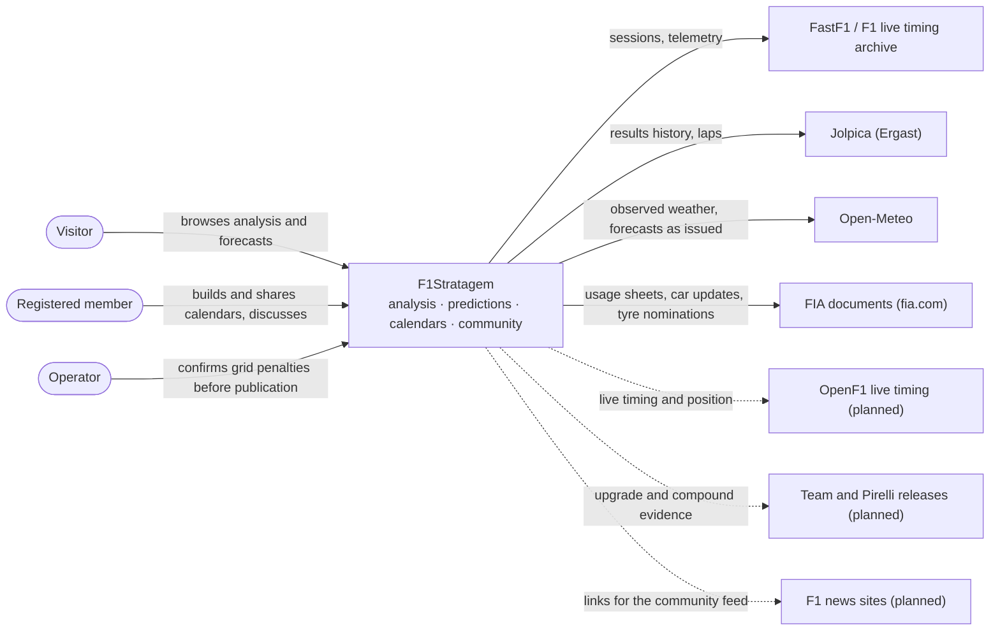

---

## System overview

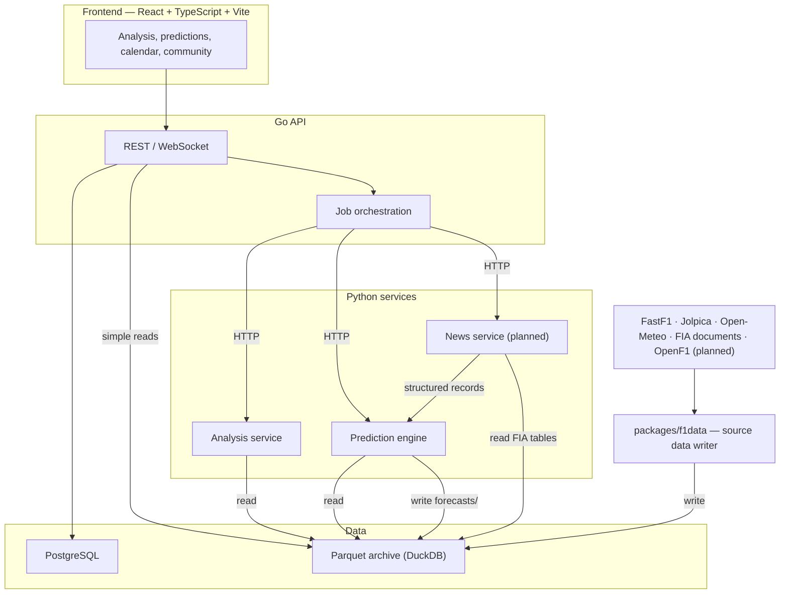

| Component | Location | Responsibility |
|---|---|---|
| Frontend | `frontend/` | UI, charts, 3D track and globe, calendar builder, community |
| API | `api/` | Public HTTP/WebSocket API, Postgres access, caching, job orchestration, auth |
| Analysis service | `services/analysis/` | Session analysis and telemetry comparison over the archive |
| Prediction engine | `services/predictor/` | Probabilistic forecasts, championship simulation, forecast ledger. No user state. |
| News service | `services/news/` | Team and Pirelli releases, selected outlets; structured upgrade records |
| Data archive | `packages/f1data/` | Sole writer of the archive's source data: collection, extraction, verification, readers |

The Go API is the only public entry point. Python services are internal and are
called over HTTP with typed contracts. For plain reads (laps, results, stints)
the API may query the archive directly through DuckDB rather than through a
Python service.

---

## Deployment

Production target. The hosting provider is not chosen yet; the shape is fixed:
only the frontend and the API are reachable from the internet, every Python
service runs on a private network, and the archive moves from local disk to
object storage in the same Parquet layout.

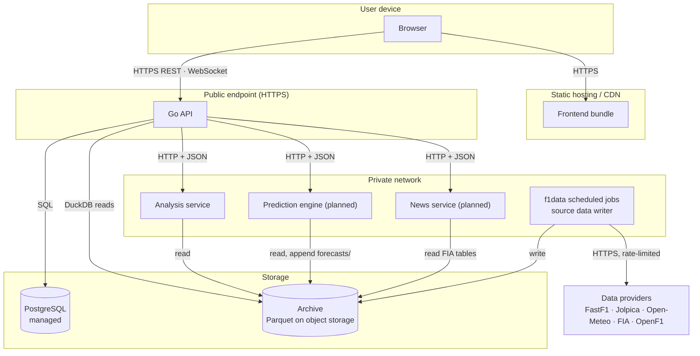

Local development: every process runs on one machine and the archive is the
repository's `data/` directory.

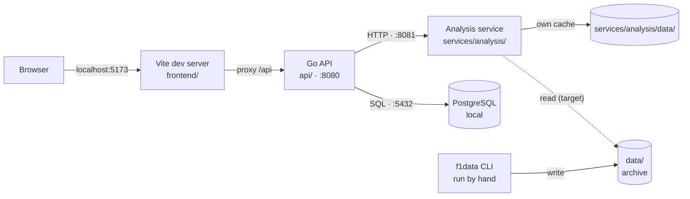

---

## Repository layout

```
F1Stratagem/
├── frontend/                 React + TypeScript + Vite + Bun
├── api/                      Go API (cmd/, internal/, migrations/)
├── services/
│   ├── analysis/             FastAPI analysis service; own cache in data/ (git-ignored)
│   ├── predictor/            Prediction engine (evaluation foundation and baselines)
│   └── news/                 News and upgrade service (planned)
├── packages/
│   └── f1data/               Archive collection, verification and readers; CLI `f1data`
├── contracts/                Service request/response schemas (added with the first contract)
├── design/                   Subsystem design documents
├── data/                     The archive (git-ignored)
├── Architecture.md
├── DataUsePlan.md            Catalogue of metrics and views
└── Makefile
```

- Each archive dataset has exactly one writer. `packages/f1data` writes all source
  data; the prediction engine writes only `data/forecasts/`, append-only. Every
  other service only reads. Services import `f1data`'s readers. Services keep their own caches under
  `services/<name>/data/`.
- `contracts/` holds JSON Schemas for every service endpoint. Go types and
  Pydantic models are tested against them, replacing the untyped
  `map[string]interface{}` responses in `api/internal/worker`.
- Each service and package has its own dependencies and is built and deployed
  alone. FastF1 is pinned to 3.9.0 everywhere, the version the archive was written
  with.
- Configuration comes from the repository's `.env` (see `.env.example`). The data
  root defaults to `<repository>/data`; `F1_DATA_ROOT` overrides it.

### Current state

- The analysis service still loads sessions through FastF1 into its own cache and
  writes per-session Parquet files there. It moves to archive reads.
- Migration `001_core_schema` stores laps, stints and weather in Postgres. These
  are served from the archive instead; Postgres keeps reference tables.
- The frontend and API predate the archive and prediction design and are being
  rebuilt around it.

---

## Data

The archive holds 2018–2026 FastF1 sessions (958 of 981 complete; the 23 gaps are
missing upstream and listed in `data/missed-sessions.json`), Jolpica history from
1950, Open-Meteo weather for every race weekend since 1950 including forecasts as
issued, and FIA documents from 2019 with parsed PU and gearbox usage, car updates
and Pirelli nominations: 37 GB, growing 3–4 GB per season. Layout, integrity
rules, extraction and time semantics: [design/data-archive.md](design/data-archive.md).

```
f1data verify          re-hash every file of every source
f1data fastf1 ingest   new sessions (after each event)
f1data fia download    new documents
```

Commands and rebuild instructions: [packages/f1data/README.md](packages/f1data/README.md).

### Licences

Before any commercial launch: Jolpica data is CC BY-NC-SA (needs permission);
Open-Meteo's free API is non-commercial (paid plan or self-hosting); FIA documents
are all rights reserved (kept private, linked to fia.com; needs consent); FOM
timing data display rights.

### PostgreSQL

Holds data that user content joins to or that the API serves transactionally:

- Reference: `seasons`, `circuits`, `circuit_layouts`, `events`, `sessions`,
  `drivers`, `teams`, `team_seasons`, `driver_seasons`, `regulation_eras`.
- Operations: `ingestion_jobs`.
- Users and community: `users`, `user_search_history`, `calendar_posts`,
  `calendar_entries`, `calendar_rotations`, `calendar_variants`.
- Predictions: `forecast_index` (event, cutoff, model version, archive path) for
  listing; forecast payloads stay in the archive.

Postgres `sessions` rows carry the archive session ID (`<year>-<round>-<slot>`).
Canonical IDs for drivers, teams and circuit layouts are shared by Postgres, the
archive, the prediction engine and the calendar builder. A layout change (new
chicane, reprofiled corner) creates a new layout ID under the same circuit.

Target schema. Migration `001_core_schema` still differs (it also holds laps,
stints, weather and session results); attributes are shown only where the DDL
below defines them.

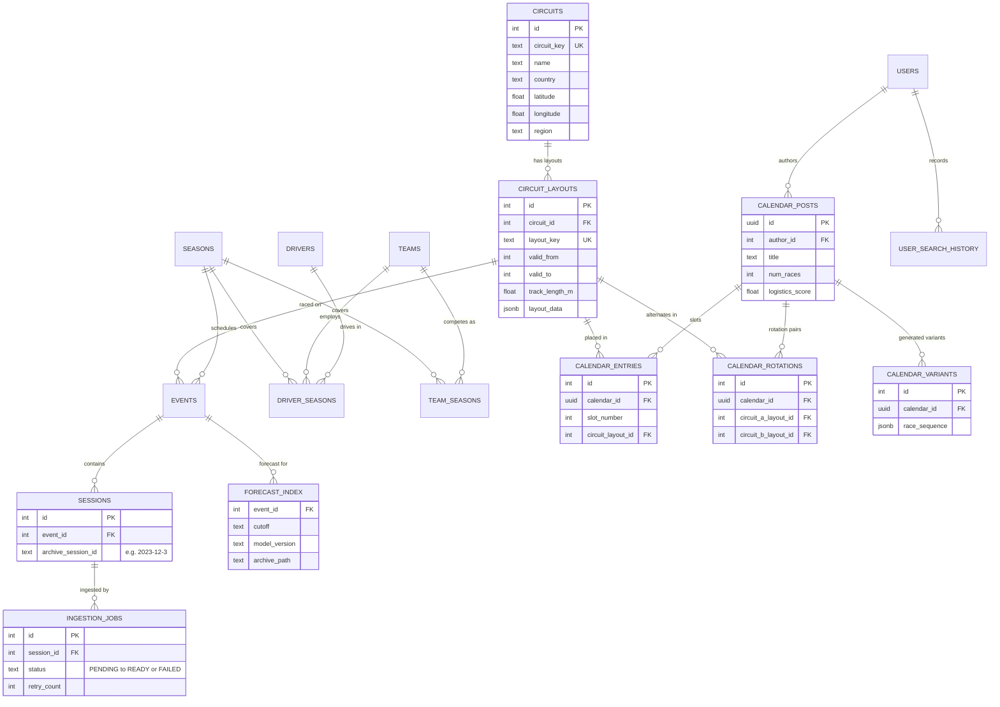

```sql
CREATE TABLE circuits (
    id              SERIAL PRIMARY KEY,
    circuit_key     TEXT UNIQUE NOT NULL,      -- "monza"
    name            TEXT NOT NULL,
    country         TEXT NOT NULL,
    city            TEXT,
    latitude        DOUBLE PRECISION,
    longitude       DOUBLE PRECISION,
    altitude_m      DOUBLE PRECISION,
    region          TEXT,                      -- calendar logistics
    first_gp_year   INT
);

CREATE TABLE circuit_layouts (
    id              SERIAL PRIMARY KEY,
    circuit_id      INT REFERENCES circuits(id),
    layout_key      TEXT UNIQUE NOT NULL,      -- "monza-2000"
    valid_from      INT NOT NULL,              -- year
    valid_to        INT,                       -- NULL = current
    track_length_m  DOUBLE PRECISION,
    num_corners     INT,
    layout_data     JSONB                      -- corner positions, sectors, DRS zones
);

CREATE TABLE ingestion_jobs (
    id              SERIAL PRIMARY KEY,
    session_id      INT REFERENCES sessions(id),
    status          TEXT NOT NULL DEFAULT 'PENDING',
    -- PENDING → DOWNLOADING → PROCESSING → READY | FAILED
    requested_by    TEXT,
    error_message   TEXT,
    retry_count     INT DEFAULT 0,
    source_version  TEXT,
    processing_version TEXT,
    created_at      TIMESTAMPTZ DEFAULT now(),
    updated_at      TIMESTAMPTZ DEFAULT now()
);

CREATE UNIQUE INDEX idx_ingestion_active
    ON ingestion_jobs(session_id)
    WHERE status IN ('PENDING', 'DOWNLOADING', 'PROCESSING');

CREATE TABLE regulation_eras (
    id              SERIAL PRIMARY KEY,
    name            TEXT NOT NULL,             -- "Ground effect 2022"
    era_type        TEXT NOT NULL,             -- technical, tyre, aero, sporting
    year_start      INT NOT NULL,
    year_end        INT,
    key_changes     JSONB
);
```

Calendar builder tables:

```sql
CREATE TABLE calendar_posts (
    id              UUID PRIMARY KEY DEFAULT gen_random_uuid(),
    author_id       INT REFERENCES users(id),
    title           TEXT NOT NULL,
    description     TEXT,
    is_featured     BOOLEAN DEFAULT false,
    is_published    BOOLEAN DEFAULT false,
    num_races       INT NOT NULL,              -- 16–24
    calendar_rules  JSONB,
    logistics_score DOUBLE PRECISION,
    total_distance_km DOUBLE PRECISION,
    created_at      TIMESTAMPTZ DEFAULT now(),
    updated_at      TIMESTAMPTZ DEFAULT now()
);

CREATE TABLE calendar_entries (
    id              SERIAL PRIMARY KEY,
    calendar_id     UUID REFERENCES calendar_posts(id) ON DELETE CASCADE,
    slot_number     INT NOT NULL,
    circuit_layout_id INT REFERENCES circuit_layouts(id),
    is_permanent    BOOLEAN DEFAULT true,
    scheduled_month INT,
    scheduled_week  INT
);

CREATE TABLE calendar_rotations (            -- e.g. Spa / Hockenheim
    id              SERIAL PRIMARY KEY,
    calendar_id     UUID REFERENCES calendar_posts(id) ON DELETE CASCADE,
    slot_number     INT NOT NULL,
    circuit_a_layout_id INT REFERENCES circuit_layouts(id),
    circuit_b_layout_id INT REFERENCES circuit_layouts(id),
    geo_distance_km DOUBLE PRECISION
);

CREATE TABLE calendar_variants (             -- generated when rotations change logistics
    id              SERIAL PRIMARY KEY,
    calendar_id     UUID REFERENCES calendar_posts(id) ON DELETE CASCADE,
    variant_label   TEXT NOT NULL,
    race_sequence   JSONB NOT NULL,
    total_distance_km DOUBLE PRECISION,
    logistics_score DOUBLE PRECISION
);
```

---

## Ingestion

- **Scheduled.** `f1data` runs after every session and as a backfill command.
  Reruns resume: verified files are skipped and cached responses reused. Each
  source respects its provider's rate limit across restarts.
- **Missing sessions.** The API never downloads inside a request. A request for a
  session not yet archived inserts an `ingestion_jobs` row (the partial unique
  index deduplicates concurrent requests) and returns `202`; the ingestion runner
  claims pending jobs; the client follows `/ws/ingestion/{job_id}`. With the
  archive complete from 2018, this covers only sessions newer than the last run.
- **Live capture (planned).** OpenF1 data is stored as provisional with receipt
  times; the FastF1 version is loaded as authoritative after the session; both are
  kept and reconciled.

Ingestion job lifecycle. The partial unique index allows one active job per
session.

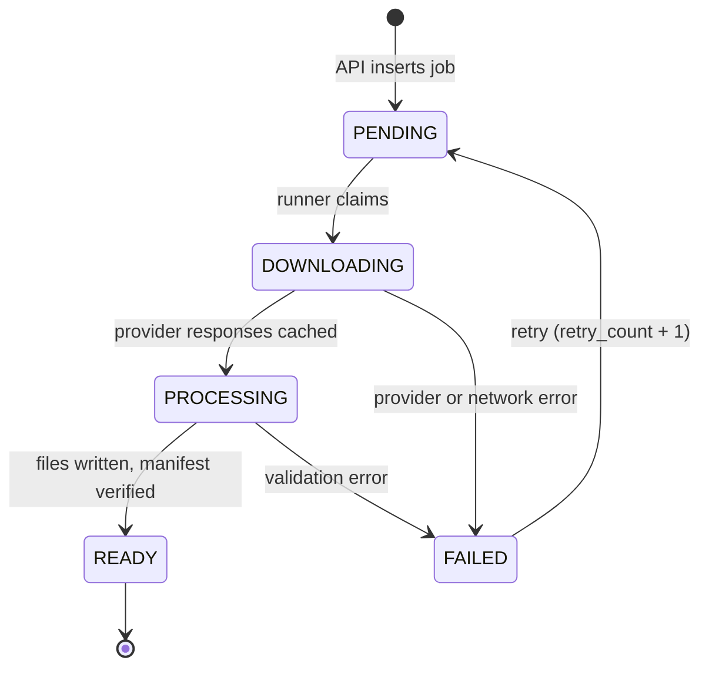

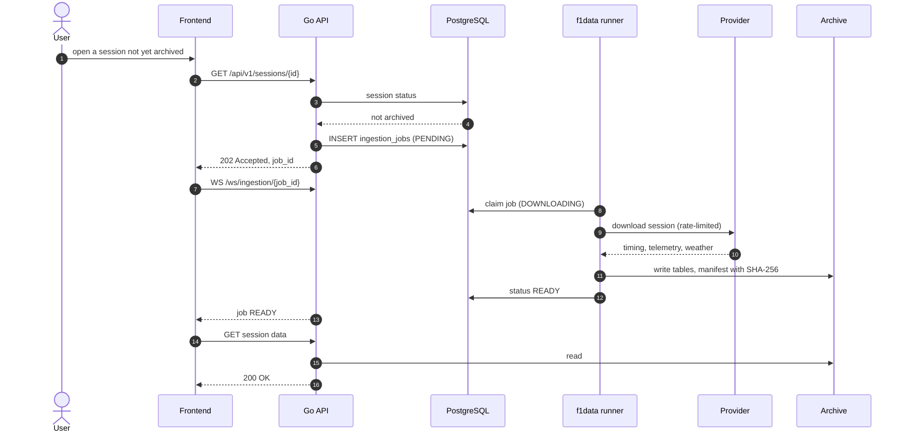

---

## Request flows

Session analysis. The analysis service reads the archive; it no longer loads
sessions from FastF1 at request time (target; see [Current state](#current-state)).

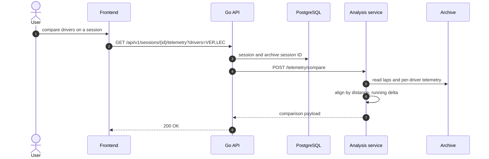

Forecast publication at a cutoff (after a practice session, after qualifying,
and so on). Penalty confirmation applies to upcoming events only, never to
backtests.

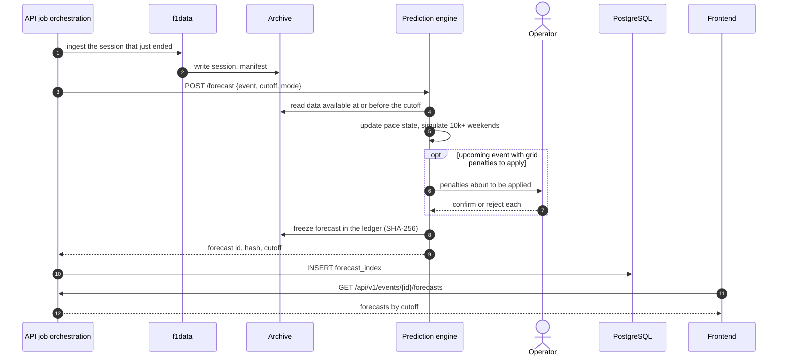

Championship on a user-built calendar. Results are cached per calendar so
identical calendars share one simulation; calendar dates use climatology, not
forecasts.

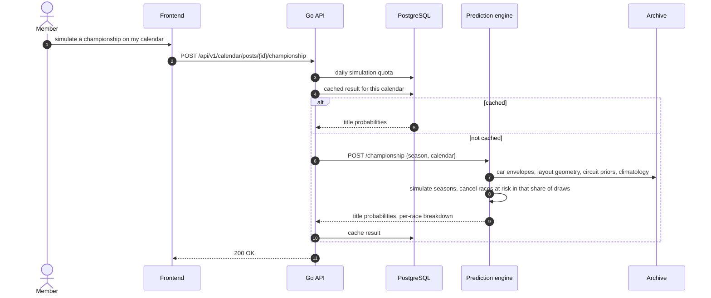

Live race forecast (planned). The pre-race and live forecasts are the same race
simulator, started from lap 0 or from the observed race state.

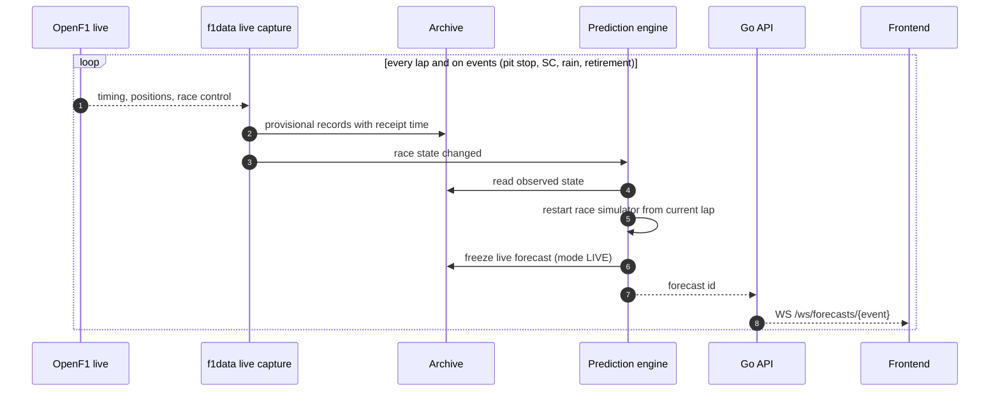

### Open decisions

- **Scheduler.** Cutoff-triggered jobs are drawn under the API's job
  orchestration; a separate scheduler process is the alternative.

---

## Prediction engine

Forecasts for every entrant in qualifying (including sprint grid sessions),
sprint and Grand Prix: full position distributions, pole probability and 80%
intervals, five-way race outcomes, expected points, and championship
probabilities rerun after every race for the real calendar and for calendars built
by users. All quantities come from one joint simulation per event, so they are
consistent by construction. Every published forecast is frozen and hashed in the
forecast ledger before its session starts. Grid penalties the model is about to
apply to an upcoming race are confirmed by an operator before publication.

Design, components (pace model, car envelope and lap simulator, run
classification, learned race events, weather scenarios, grid penalties, tyre
strategy, simulators) and evaluation: [design/prediction-engine.md](design/prediction-engine.md).

---

## News

Two separate paths:

- **Model evidence** (`services/news`): team and Pirelli releases and selected
  outlets, deduplicated and extracted into structured, timestamped records. FIA
  documents are collected by the archive, not by this service. See
  [design/news-intelligence.md](design/news-intelligence.md).
- **Community feed** (community phase): an hourly scraper listing all F1 news as
  headline, source, time and link (never republished), each with a discussion
  thread. Unrelated to the model.

---

## API

Implemented routes (`api/internal/server/server.go`):

```
GET  /health
GET  /api/v1/seasons
GET  /api/v1/seasons/{year}
POST /api/v1/seasons/{year}/sync
GET  /api/v1/seasons/{year}/events
GET  /api/v1/events/{eventId}/sessions
GET  /api/v1/sessions/{sessionId}
GET  /api/v1/sessions/{sessionId}/results
GET  /api/v1/sessions/{sessionId}/laps
GET  /api/v1/sessions/{sessionId}/stints
GET  /api/v1/sessions/{sessionId}/weather
GET  /api/v1/sessions/{sessionId}/telemetry
POST /api/v1/sessions/{sessionId}/ingest
GET  /api/v1/sessions/{sessionId}/ingest/status
GET  /api/v1/drivers
GET  /api/v1/teams
GET  /api/v1/circuits
```

Planned:

```
GET  /api/v1/drivers/{code}                     driver profile
GET  /api/v1/teams/{key}                        team and car profile
GET  /api/v1/circuits/{key}                     circuit profile, corner classes, regime mix
GET  /api/v1/events/{eventId}/forecasts         forecasts for the event, by cutoff
GET  /api/v1/forecasts/{forecastId}             full forecast payload
GET  /api/v1/forecasts/{forecastId}/review      post-race attribution
GET  /api/v1/seasons/{year}/championship        title probabilities and their history
GET  /api/v1/ledger                             frozen forecasts, hashes, track record
WS   /ws/forecasts/{eventId}                    live forecast updates
WS   /ws/ingestion/{jobId}                      ingestion progress
GET  /api/v1/news                               verified news

Phase 4
POST /api/v1/auth/register, /auth/login; GET /auth/me
GET|POST /api/v1/user/history
GET|POST /api/v1/calendar/posts; GET|PUT /calendar/posts/{id}
GET  /api/v1/calendar/circuits
POST /api/v1/calendar/logistics
POST /api/v1/calendar/posts/{id}/championship   simulate a season on this calendar
GET  /api/v1/community/news                     community news feed and threads
```

Internal service endpoints:

```
analysis   GET  /health
           GET  /schedule/{year}
           POST /session/extract
           POST /telemetry/compare
predictor  GET  /health
           POST /forecast            {event, cutoff, mode} → forecast
           POST /replay              {event, from_lap}     → stream of forecasts
           POST /championship        {season, calendar?}   → title probabilities
           GET  /models/current      model version, training data fingerprint
```

---

## Frontend

React 19, strict TypeScript, Vite, Bun, Tailwind CSS v4, React Router 7, Apache
ECharts, Three.js / React Three Fiber. No Next.js. The current pages (session
browser, multi-driver telemetry comparison, 3D track) are being rebuilt around the
archive, predictions and community features.

```
/, /season/:year          home, season browser
/session/:id              session analysis
/compare/:sessionId       telemetry comparison (up to 4 drivers)
/races/:year/:round       race analysis
/standings                championship standings
/drivers/:code            driver profile
/teams/:key               team and car profile
/circuits/:key            circuit profile
/predictions/:event       forecasts by cutoff, intervals, live view
/championship/:year       title probabilities through the season
/ledger                   forecast track record
/news                     verified news
/calendar, /calendar/create, /calendar/:id
/community                community feed and discussions
```

---

## Roadmap

| Phase | Focus |
|---|---|
| 1 | Core analysis: session browser, telemetry comparison (in place, to be rebuilt) |
| 1b | Monorepo and shared archive (done); analysis on archive reads; typed contracts; canonical driver, team and circuit IDs |
| 2 | Prediction engine, built one feature at a time: pace model, circuit and car profiles, envelope and lap simulator, qualifying and race simulators; forecasts published per cutoff; forecast ledger; championship forecast after every race |
| 3 | Deep analytics: driver, car and circuit profiles, sharing the prediction engine's profile pipeline (corner classes, track mixes, car profiles) |
| 4 | Calendar builder, accounts, community sharing and news feed; championship simulation on user calendars |
| 5 | Replay and live forecasting; news service |
| 6 | Strategy tools, scenario simulation, career priors |

---

## Verification

- `go test ./...` for the API; `pytest` per Python package and service.
- `f1data verify`: checksum audit of every archived file.
- Contract tests: Go and Python payloads validated against `contracts/` schemas.
- Prediction engine: walk-forward evaluation and consistency checks (probability
  sums, monotonic derived quantities) on every model version.
