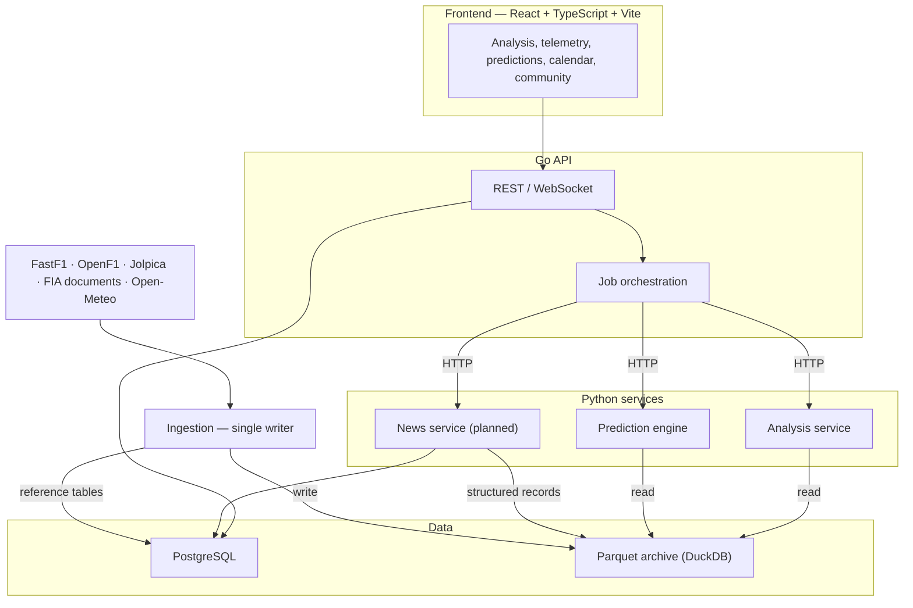

# F1Stratagem — Architecture

F1Stratagem is an F1 analysis and community platform: detailed session and race
analysis, telemetry comparison, a calendar builder, community sharing, and
probabilistic predictions for every driver in every session.

The repository is a monorepo of independently deployable services that share one
data archive.

---

## Decisions

| Decision | Choice | Rationale |
|---|---|---|
| API language | Go | Concurrency, mature HTTP/Postgres ecosystem. The bottleneck is data, not the API. |
| Numerical work | Python services (FastAPI) | pandas/DuckDB/FastF1/scientific stack. Called by Go over HTTP. |
| Repository | Monorepo, independently deployable services | Shared contracts and data code; separate processes and deploys. |
| F1 timing and telemetry | Parquet archive queried with DuckDB | Columnar, compressed, partition-scanned; hundreds of millions of telemetry rows. SQLite rejected. |
| Application data | PostgreSQL (local in development) | Users, calendars, community content, small F1 reference tables they join to. |
| Archive ownership | One writer (ingestion), many readers | Avoids concurrent-write corruption; one place defines the data. |
| Data range | 2018 onward for timing/telemetry; 1950 onward for results | FastF1 telemetry starts in 2018; Jolpica covers results history. |
| Historical source of record | Own archive | FastF1 requires an F1TV subscription since October 2026; data is needed for retraining, backtests, replay and analysis. |
| Live data | OpenF1 (provisional) + FastF1 (authoritative), both kept | Post-session corrections; real receipt times enable strict backtests. |
| Charts | Apache ECharts; Three.js / React Three Fiber for 3D | Large telemetry series; 3D track and globe. |
| Authentication | Phase 2 (JWT) | Analysis is public; accounts arrive with the calendar builder and community. |

---

## System overview



| Component | Language | Responsibility |
|---|---|---|
| Frontend | TypeScript / React | UI, charts, 3D track and globe, calendar builder |
| API | Go | Public HTTP/WebSocket API, Postgres access, caching, job orchestration, auth (Phase 2) |
| Analysis service | Python | Read-only queries over the archive: laps, stints, telemetry comparison, derived metrics |
| Prediction engine | Python | Probabilistic forecasts for qualifying, sprint and race; replay and live updates. No user state. |
| News service | Python | Collects news and FIA documents, publishes verified items, emits structured upgrade/penalty records |
| Ingestion (`f1data`) | Python | The only writer to the archive. Downloads, validates, normalises, records manifests. |
| PostgreSQL | — | Users, calendars, community content, F1 reference tables |
| Archive | — | Timing, telemetry, weather, race control, derived features, forecasts |

The Go API is the only public entry point. Python services are internal and are
called over HTTP with typed contracts.

---

## Repository layout

```
F1Stratagem/
├── frontend/                 React + TypeScript + Vite + Bun
├── api/                      Go API (cmd/, internal/, migrations/)
├── services/
│   ├── analysis/             FastAPI analysis service (today: worker/)
│   ├── predictor/            Prediction engine service
│   └── news/                 News and upgrade service (planned)
├── packages/
│   └── f1data/               Archive ingestion (single writer) and shared readers
├── contracts/                Request/response schemas shared by Go and Python
├── data/                     Archive root (git-ignored)
├── Architecture.md
├── DataUsePlan.md
└── Makefile
```

- `packages/f1data` is the only code that writes `data/`. Services import its
  read functions; they never write the archive.
- `contracts/` holds JSON Schemas for every service endpoint. Go types and
  Pydantic models are generated or tested against them, replacing the untyped
  `map[string]interface{}` responses in `api/internal/worker`.
- Each service has its own dependency lock and can be built and deployed alone.
  FastF1 is pinned to one version across the repository (the archive was written
  with 3.9.0).

### Current state

- `worker/` is the analysis service. It still loads sessions through FastF1 into
  its own cache under `worker/data/` and writes per-session Parquet files there.
  It moves to `services/analysis/` and switches to archive reads.
- Migration `001_core_schema` stores laps, stints and weather in Postgres. These
  move to the archive; Postgres keeps reference tables and final results.
- The archive pipeline and prediction engine are developed in a separate
  repository and move into `packages/f1data` and `services/predictor`.

---

## Data

### Archive

```
data/
  cache/fastf1_http_cache.sqlite      raw provider responses; replayable offline
  sessions/<year>/<session-id>/
    manifest.json                     status, files, row counts, SHA-256, schema, errors
    source/<table>.parquet            FastF1 tables, provider columns unchanged
    normalized/<table>.parquet        core tables + session metadata columns
    source/{car_data,pos_data}/driver-<n>.parquet   telemetry, stored once
  schedules/<year>.parquet            provider schedule including testing
  catalog/<year>.json                 discovery selection and exclusions
  inventory.json, progress.json       session ledger
  snapshots/                          timestamped acquisition receipts
  prepared/, experiments/             fingerprinted derived builds
  forecasts/                          issued forecasts, immutable, SHA-256 identified
```

- Session ID: `<year>-<round>-<slot>` (e.g. `2023-12-3`); testing
  `<year>-T<n>-<slot>`. Postgres `sessions` rows carry this ID as their link to the
  archive.
- Core tables: `laps`, `results`, `weather`, `track_status`, `session_status`,
  `race_control`. Telemetry covers every session, practice and testing included.
- Writes go to a temp file, are read back and atomically promoted. A session is
  complete only when every file matches its manifest checksum.
- FastF1's parsed pickle cache is disabled; it duplicates `source/` and can be
  rebuilt offline from the raw HTTP cache.

Measured size is ~40 MB per session with telemetry. The full 2018–2026 archive
with testing is ~50 GB; with OpenF1, FIA documents, derived builds and models the
planned total is ~125–190 GB, growing ~8–12 GB per season.

### Time semantics

Every record has an event time and, where known, an availability time (when it
could have been known). A forecast may only read records available at or before
its cutoff. Historical data downloaded today has no verified publication times, so
backtests on it run in `archive_proxy` mode and are labelled retrospective. Data
captured live carries real receipt times and supports strict backtests.

### PostgreSQL

Holds data that user content joins to or that the API serves transactionally:

- Reference: `seasons`, `circuits`, `circuit_layouts`, `events`, `sessions`,
  `drivers`, `teams`, `team_seasons`, `driver_seasons`, `session_results` (final
  classification), `regulation_eras`.
- Operations: `ingestion_jobs`.
- Users and community (Phase 2): `users`, `user_search_history`,
  `calendar_posts`, `calendar_entries`, `calendar_rotations`, `calendar_variants`.
- Predictions: `forecast_index` (event, cutoff, model version, archive path) for
  listing; forecast payloads stay in the archive.

Canonical IDs for drivers, teams and circuit layouts are shared by Postgres, the
archive, the prediction engine and the calendar builder. A layout change (new
chicane, reprofiled corner) creates a new layout ID under the same circuit.

```sql
CREATE TABLE circuits (
    id              SERIAL PRIMARY KEY,
    circuit_key     TEXT UNIQUE NOT NULL,      -- "monza"
    name            TEXT NOT NULL,
    country         TEXT NOT NULL,
    city            TEXT,
    latitude        DOUBLE PRECISION,
    longitude       DOUBLE PRECISION,
    altitude_m      DOUBLE PRECISION,
    region          TEXT,                      -- calendar logistics
    first_gp_year   INT
);

CREATE TABLE circuit_layouts (
    id              SERIAL PRIMARY KEY,
    circuit_id      INT REFERENCES circuits(id),
    layout_key      TEXT UNIQUE NOT NULL,      -- "monza-2000"
    valid_from      INT NOT NULL,              -- year
    valid_to        INT,                       -- NULL = current
    track_length_m  DOUBLE PRECISION,
    num_corners     INT,
    layout_data     JSONB                      -- corner positions, sectors, DRS zones
);

CREATE TABLE ingestion_jobs (
    id              SERIAL PRIMARY KEY,
    session_id      INT REFERENCES sessions(id),
    status          TEXT NOT NULL DEFAULT 'PENDING',
    -- PENDING → DOWNLOADING → PROCESSING → READY | FAILED
    requested_by    TEXT,
    error_message   TEXT,
    retry_count     INT DEFAULT 0,
    source_version  TEXT,
    processing_version TEXT,
    created_at      TIMESTAMPTZ DEFAULT now(),
    updated_at      TIMESTAMPTZ DEFAULT now()
);

CREATE UNIQUE INDEX idx_ingestion_active
    ON ingestion_jobs(session_id)
    WHERE status IN ('PENDING', 'DOWNLOADING', 'PROCESSING');

CREATE TABLE regulation_eras (
    id              SERIAL PRIMARY KEY,
    name            TEXT NOT NULL,             -- "Ground effect 2022"
    era_type        TEXT NOT NULL,             -- technical, tyre, aero, sporting
    year_start      INT NOT NULL,
    year_end        INT,
    key_changes     JSONB
);
```

Calendar builder tables (Phase 2):

```sql
CREATE TABLE calendar_posts (
    id              UUID PRIMARY KEY DEFAULT gen_random_uuid(),
    author_id       INT REFERENCES users(id),
    title           TEXT NOT NULL,
    description     TEXT,
    is_featured     BOOLEAN DEFAULT false,
    is_published    BOOLEAN DEFAULT false,
    num_races       INT NOT NULL,              -- 16–24
    calendar_rules  JSONB,
    logistics_score DOUBLE PRECISION,
    total_distance_km DOUBLE PRECISION,
    created_at      TIMESTAMPTZ DEFAULT now(),
    updated_at      TIMESTAMPTZ DEFAULT now()
);

CREATE TABLE calendar_entries (
    id              SERIAL PRIMARY KEY,
    calendar_id     UUID REFERENCES calendar_posts(id) ON DELETE CASCADE,
    slot_number     INT NOT NULL,
    circuit_layout_id INT REFERENCES circuit_layouts(id),
    is_permanent    BOOLEAN DEFAULT true,
    scheduled_month INT,
    scheduled_week  INT
);

CREATE TABLE calendar_rotations (            -- e.g. Spa / Hockenheim
    id              SERIAL PRIMARY KEY,
    calendar_id     UUID REFERENCES calendar_posts(id) ON DELETE CASCADE,
    slot_number     INT NOT NULL,
    circuit_a_layout_id INT REFERENCES circuit_layouts(id),
    circuit_b_layout_id INT REFERENCES circuit_layouts(id),
    geo_distance_km DOUBLE PRECISION
);

CREATE TABLE calendar_variants (             -- generated when rotations change logistics
    id              SERIAL PRIMARY KEY,
    calendar_id     UUID REFERENCES calendar_posts(id) ON DELETE CASCADE,
    variant_label   TEXT NOT NULL,
    race_sequence   JSONB NOT NULL,
    total_distance_km DOUBLE PRECISION,
    logistics_score DOUBLE PRECISION
);
```

### Sources

| Source | Coverage | Use |
|---|---|---|
| FastF1 | 2018+ timing, telemetry, weather, race control, testing | Primary archive (F1TV auth, 500 calls/hour) |
| Jolpica (Ergast successor) | Results and standings 1950+ | History, cross-check |
| OpenF1 | 2023+ history; live timing | Live capture, cross-check |
| Open-Meteo historical forecasts | Forecasts as issued | Weather at forecast cutoff |
| FIA documents | Car presentation sheets, decisions, classifications | Upgrades, penalties, power unit component usage |
| Betting markets | Pre-session odds, where licensable | Evaluation benchmark only |
| Junior and other series results | F2, F3, karting, sportscar, rally | Driver career priors (later) |

Rights for public display of timing data and news content are confirmed before
launch.

---

## Ingestion

### Archival

`packages/f1data` runs as a scheduled job after every session and as a backfill
command. Reruns resume: verified sessions are skipped and cached responses
reused. On the FastF1 rate limit it waits and retries the same session.

### Requests for missing sessions

The API never downloads data inside a request. If a user asks for a session that
is not in the archive:

1. The API inserts an `ingestion_jobs` row (the partial unique index deduplicates
   concurrent requests) and returns `202` with the job ID.
2. The ingestion runner, the single writer, claims pending jobs in order.
3. The client follows progress over `/ws/ingestion/{job_id}` or polls status.

With the archive complete from 2018, this path only covers sessions that finished
after the last scheduled run.

### Live capture and reconciliation (planned)

During a session OpenF1 data is stored as provisional with receipt times. After the
session the FastF1 version is loaded as authoritative. Both are kept; a
reconciliation step diffs them and flags mismatches instead of overwriting. Late
penalties and reclassifications come from the authoritative version.

---

## Prediction engine

Produces forecasts for every entrant: qualifying (including sprint grid sessions),
sprint and Grand Prix.

### Outputs

- Full position distribution and expected position for every driver.
- Qualifying: pole probability and a central 80% interval (e.g. P3–P7).
- Race: `win`, `other_points_finish`, `outside_points_finish`,
  `mechanical_retirement`, `incident_or_other_retirement`, summing to 1; podium,
  top-5, top-10, points and finish probabilities; expected championship points.
- Championship: drivers' and constructors' title and final-position probabilities,
  for the real calendar and for user-built calendars.
- Every forecast records cutoff, sources, model version, data freshness and mode
  (`LIVE`, `REPLAY`, `OFFLINE`).

All quantities come from one joint simulation per event, so they are consistent
by construction: one winner per draw, win ≤ podium, each position column sums to 1.

### Cutoffs

Before the weekend, after testing, after each practice session, after sprint
sessions, after qualifying, after published grid penalties, before the race, and
live (per lap and on events: pit stops, SC/VSC, red flags, rain, incidents,
penalties).

### Model

1. **Pace state.** Lap time decomposes into track/session, car, driver, tyre
   compound × age, fuel, track evolution, traffic and noise. Car and driver
   strength are latent states updated by every session. Over the winter they carry
   over with inflated variance, more at regulation changes (2022, 2026); the
   amount is fitted from history, which captures a stable front and a shuffling
   midfield. Early-season forecasts therefore lean on the previous season, testing
   and practice without a hand-set switch.
2. **Session transfer offsets.** Team × session-type offsets (practice →
   qualifying → race), shrunk toward zero, capture patterns such as higher engine
   modes in practice. Human knowledge enters as timestamped, logged priors that are
   evaluated like any other input and lose weight if they do not help.
3. **Circuit and car profiles.** Corners are classified slow/medium/fast from
   entry, minimum and exit speeds measured in telemetry; no manual labels. A track
   profile is the share of lap time in each regime (straights and corner classes),
   so a track is a weighted mix. A car profile is time gained or lost per regime,
   top speed and traction, per team per session. This separates a low-drag car
   from one that is fast because it loses little in corners, and transfers
   performance between circuits by characteristics, not by results.
4. **Performance envelope and lap simulation.** Each car's physical limits are
   fitted per team per weekend from telemetry and position data: lateral grip as a
   function of speed (aero), traction out of slow corners, braking, and the
   power/drag balance seen in acceleration and top speed. From 2026, energy
   deployment limits are part of the envelope (speed fade at the end of long
   straights). A quasi-steady-state lap simulator drives each envelope around a
   layout's geometry (curvature from position data) to give expected lap-time
   differences. This explains why a car is fast, transfers to circuits with layout
   changes or no recent history, and supplies circuit pace for user-built
   calendars. The regime profile in (3) remains as a simpler baseline and check.
5. **Practice run classification.** Fuel load, engine modes and run plans are not
   observed. Each practice run is classified (qualifying simulation, long run,
   short run, programme/aero work) from stint length, lap-time pattern, compound
   and timing within the session. Run types set the fuel-and-mode uncertainty of
   every lap entering the pace state, which addresses practice pace that does not
   carry into qualifying at its source; the session offsets in (2) absorb what
   remains.
6. **Clean-air pace.** Gap to the car ahead, from position data, tags each lap as
   free air or traffic. The pace state is fitted on free-air laps with a learned
   dirty-air penalty for the rest.
7. **Driver effects.** Teammate-relative pace, qualifying execution, wet pace,
   starts, consistency, errors, and circuit-specific effects partially pooled by
   sample size. Career history from junior and other series gives weak priors for
   rookies (later phase); missing history is not treated as weakness.
8. **Hazards and circuit priors.** Mechanical and incident retirement hazards;
   SC/VSC/red-flag hazard per lap (with the lap-1 spike); pit loss and strategy
   patterns per circuit layout.
9. **Learned race events.** Each race-simulator rule is a model fitted from data:
   - Start: positions gained or lost on lap 1 by grid slot, grid side and team
     launch performance.
   - Overtaking: pass probability from real wheel-to-wheel battles in position
     data, as a function of pace delta, circuit, tyre offset and DRS (or the 2026
     overtake mode).
   - Pit decisions: pit-stop hazard conditioned on tyre age, compound, gaps and
     neutralisations; undercut and overcut gains measured per circuit.
10. **Weather scenarios.** Forecast rain probability (as issued at the cutoff)
    splits the simulation into dry, mixed and wet scenarios, weighted by
    probability. A learned per-driver wet-pace effect applies in wet draws.
11. **Grid penalty forecasts.** Power unit and gearbox component usage per driver,
    tracked from FIA documents against the season allocation, gives the
    probability of a component penalty at each upcoming event. Pre-weekend and
    championship forecasts sample these penalties.
12. **Simulators.** A qualifying simulator (Q1/Q2/Q3 knockouts, track evolution,
    mistakes, red flags) and a lap-level race simulator (degradation, fuel, dirty
    air, the learned event models above, shared neutralisations, retirements,
    classification and points rules per season). Live forecasting restarts the
    race simulator from the observed state.
13. **External evidence.** Upgrade and penalty records from the news service mark
    when and where to look; effects are measured as changes in the car envelope
    and profile, not taken from claims.

### Championship simulation

The season simulator runs the weekend simulator over every remaining event, from
the current standings, with car and driver states evolving between events
(including expected development and upgrade uncertainty) and penalties sampled.

- Rerun after every race (and at the season start, after testing). Uncertainty
  narrows as the season progresses; the history of title probabilities over the
  season is stored and shown.
- Custom calendars: the same simulator runs over a calendar built by a user in
  the calendar builder, using the lap simulator for circuit pace and the circuit
  priors for event hazards. Circuits without recent F1 data are flagged with wider
  uncertainty. The calendar builder's core purpose is picking and sharing
  calendars; championship prediction is an optional layer on top.

### Forecast ledger

Every published forecast is frozen before its session starts: the payload,
model version, training data fingerprint and input cutoff are written to the
archive and identified by a SHA-256 hash. Forecasts are never edited after
publication; corrections are new versions.

- Published on the site: frozen forecasts, calibration and interval coverage, and
  the methodology. Fixed seeds make any forecast reproducible from its recorded
  inputs.
- Betting-market odds, where licensable, are a benchmark only and never a model
  input.
- Outcomes far from the forecast are surfaced as "against the forecast" moments:
  e.g. a championship won by a driver whose title probability stayed low all
  season, shown with the full probability history from the ledger. These are
  shareable to the community.

### Evaluation

- Walk-forward over events: 2018 warm-up, 2019–2023 development and calibration,
  2024 validation, 2025–2026 held out until model selection.
- Metrics: log loss, Brier, ranked probability score, calibration, position MAE,
  interval coverage, expected-points error, retirement calibration. Reported by
  season, circuit, weather, cutoff and position band (front, midfield, back).
- Baselines: uniform, qualifying order, previous model version; betting markets
  as an external benchmark. A version is promoted only if it beats the current one
  on held-out events.
- Championship forecasts are evaluated by replaying past seasons race by race.
- After each race, misses are attributed to pace, strategy, reliability, incident,
  weather, penalty, data issue or variance. Retraining is scheduled, not triggered
  by a single surprise.

### Integrity rules

- No information after a cutoff is used for that forecast.
- No invented data, causes or accuracy figures; missing stays missing.
- Probabilities finite and in [0, 1]; runs reproducible with fixed seeds.

---

## News service (planned)

Collects FIA documents first (car presentation sheets list every team's new parts
and their stated purpose; stewards' decisions; grid penalties), then team releases
and selected outlets. Items are deduplicated with every source and publication
time. A language model extracts structured records (team, component, type, stated
purpose, first event, affected regimes, confidence) and never produces model
numbers. The site shows headline, summary, source link and time; full articles are
not republished. Interpretive signals are used by the engine only if they improve
walk-forward results. The engine runs normally when this service is unavailable.

---

## API

Implemented routes (`api/internal/server/server.go`):

```
GET  /health
GET  /api/v1/seasons
GET  /api/v1/seasons/{year}
POST /api/v1/seasons/{year}/sync
GET  /api/v1/seasons/{year}/events
GET  /api/v1/events/{eventId}/sessions
GET  /api/v1/sessions/{sessionId}
GET  /api/v1/sessions/{sessionId}/results
GET  /api/v1/sessions/{sessionId}/laps
GET  /api/v1/sessions/{sessionId}/stints
GET  /api/v1/sessions/{sessionId}/weather
GET  /api/v1/sessions/{sessionId}/telemetry
POST /api/v1/sessions/{sessionId}/ingest
GET  /api/v1/sessions/{sessionId}/ingest/status
GET  /api/v1/drivers
GET  /api/v1/teams
GET  /api/v1/circuits
```

Planned:

```
GET  /api/v1/drivers/{code}                     driver profile
GET  /api/v1/teams/{key}                        team and car profile
GET  /api/v1/circuits/{key}                     circuit profile, corner classes, regime mix
GET  /api/v1/events/{eventId}/forecasts         forecasts for the event, by cutoff
GET  /api/v1/forecasts/{forecastId}             full forecast payload
GET  /api/v1/forecasts/{forecastId}/review      post-race attribution
GET  /api/v1/seasons/{year}/championship       title probabilities and their history
GET  /api/v1/ledger                             frozen forecasts, hashes, track record
WS   /ws/forecasts/{eventId}                    live forecast updates
WS   /ws/ingestion/{jobId}                      ingestion progress
GET  /api/v1/news                               verified news feed

Phase 2
POST /api/v1/auth/register, /auth/login; GET /auth/me
GET|POST /api/v1/user/history
GET|POST /api/v1/calendar/posts; GET|PUT /calendar/posts/{id}
GET  /api/v1/calendar/circuits
POST /api/v1/calendar/logistics
POST /api/v1/calendar/posts/{id}/championship   simulate a season on this calendar
```

Internal service endpoints (not exposed publicly):

```
analysis   GET  /health
           GET  /schedule/{year}
           POST /session/extract
           POST /telemetry/compare
predictor  GET  /health
           POST /forecast            {event, cutoff, mode} → forecast
           POST /replay              {event, from_lap}     → stream of forecasts
           POST /championship        {season, calendar?}   → title probabilities
           GET  /models/current      model version, training data fingerprint
```

---

## Frontend

React 19, strict TypeScript, Vite, Bun, Tailwind CSS v4, React Router 7, Apache
ECharts, Three.js / React Three Fiber, lucide icons, axios. No Next.js.

- ECharts for synchronized telemetry and analysis charts (100k+ points, zoom,
  brush).
- Three.js for the 3D track built from FastF1 position data and, in Phase 2, the
  calendar globe (circuit picking, drag-and-drop ordering, travel routes,
  logistics).

Pages:

```
/, /season/:year          home, season browser
/session/:id              session analysis
/compare/:sessionId       telemetry comparison (up to 4 drivers)
/races/:year/:round       race analysis
/standings                championship standings
/drivers/:code            driver profile
/teams/:key               team and car profile
/circuits/:key            circuit profile
/predictions/:event       forecasts by cutoff, intervals, live view
/championship/:year       title probabilities through the season
/ledger                   forecast track record
/news                     verified news
/calendar, /calendar/create, /calendar/:id     Phase 2
```

---

## Roadmap

| Phase | Focus |
|---|---|
| 1 | Core analysis: session browser, telemetry comparison, race and qualifying analysis (largely in place) |
| 1b | Monorepo merge, shared archive, analysis service on archive reads, typed contracts, canonical IDs |
| 2 | Calendar builder, accounts, community sharing |
| 3 | Deep analytics: driver, car and circuit profiles (shared with the prediction engine) |
| 4 | Prediction engine: qualifying and race forecasts with intervals, published per cutoff; forecast ledger; championship forecast after every race |
| 5 | Replay and live forecasting; news and upgrade service; championship simulation on user calendars |
| 6 | Strategy tools, scenario simulation, career priors |

The prediction engine is developed alongside phases 1b–3; its profile pipeline
(corner classes, track mixes, car profiles) also powers the phase 3 views.

---

## Verification

- `go test ./...` for the API; `pytest` per Python service.
- Archive integrity: manifest checksum verification over all sessions.
- Contract tests: Go and Python payloads validated against `contracts/` schemas.
- Prediction engine: walk-forward evaluation report and consistency checks
  (probability sums, monotonic derived quantities) on every model version.
