# F1Stratagem — Architecture

F1Stratagem is an F1 analysis and community platform: detailed session and race
analysis, telemetry comparison, a calendar builder, community sharing, and
probabilistic predictions for every driver in every session.

The repository is a monorepo of independently deployable services that share one
data archive. Subsystem designs live in [`design/`](design/):

- [Data archive](design/data-archive.md): sources, layout, integrity, time semantics.
- [Prediction engine](design/prediction-engine.md): model, simulators, evaluation, forecast ledger.
- [News and upgrade intelligence](design/news-intelligence.md): official evidence for the engine.

### Diagrams

Diagrams are Mermaid, kept next to the text they illustrate, and updated with
the decision they describe. Mermaid has no native UML component, deployment or
use-case notation, so those views are drawn as flowcharts.

| View | Kind | Location |
|---|---|---|
| System context | Flowchart | [System context](#system-context) |
| Containers and data stores | Flowchart | [System overview](#system-overview) |
| Production deployment and network | Flowchart | [Deployment](#deployment) |
| Local development | Flowchart | [Deployment](#deployment) |
| Database schema (target) | ER | [PostgreSQL](#postgresql) |
| Ingestion job lifecycle | State | [Ingestion](#ingestion) |
| Missing-session ingestion | Sequence | [Ingestion](#ingestion) |
| Session analysis request | Sequence | [Request flows](#request-flows) |
| Forecast publication at a cutoff | Sequence | [Request flows](#request-flows) |
| Championship on a user calendar | Sequence | [Request flows](#request-flows) |
| Live race forecast (planned) | Sequence | [Request flows](#request-flows) |
| Archive data flow, `f1data` packages, session manifest states, FastF1 ingestion | Flowchart, class, state, sequence | [design/data-archive.md](design/data-archive.md) |
| Prediction pipeline, pace model, Python/Rust split of the filter, cutoff timeline, forecast lifecycle, output model, feature evaluation | Flowchart, state, class | [design/prediction-engine.md](design/prediction-engine.md) |
| News pipeline, upgrade-effect measurement | Flowchart, sequence | [design/news-intelligence.md](design/news-intelligence.md) |

---

## Decisions

| Decision | Choice | Rationale |
|---|---|---|
| API language | Go | Concurrency, mature HTTP/Postgres ecosystem. Public entry point and orchestrator of all services. |
| Numerical work | Prediction engine: Python with Rust kernels. Analysis service: Rust | Prediction engine: DuckDB, Polars and NumPy do the heavy work in native code; components move to Rust extension modules (PyO3, built with maturin, in `services/predictor/kernels/`) when that makes them faster or better with the same forecasts; Python stays for optimisers, data handling and evaluation. In place: the pace model's Kalman filter (4.3–6.4× faster fits) and the race simulation (27–41×), with the same forecasts (identical for the filter; the same distribution for the simulation, which draws its own random numbers). The analysis service is a Rust crate: telemetry and lap maths for the website, one process. |
| Repository | Monorepo, independently deployable services | Shared contracts and data code; separate processes and deploys. |
| F1 timing, telemetry, documents | Parquet archive | Columnar, compressed, partition-scanned; hundreds of millions of telemetry rows. SQLite rejected. |
| Archive access | `f1data` is the only writer. Readers: the prediction engine (its own needs) and the analysis service (raw timing and telemetry for the website). The Go API never reads the raw archive | The archive layout and the telemetry maths (lap windows, merging car and position data, distance, alignment between drivers, time deltas) live in one place. Rejected: the API reading telemetry itself (DuckDB in Go needs a C++ build, and the logic would exist twice); moving analysis into `api/` (folders do not change efficiency, processes do: the maths would be rewritten in Go or called from Go through a C interface). |
| Analysis results | Precomputed after each session, the rest computed on demand and cached | What most visitors open is ready before they ask: fastest-lap and qualifying-lap traces on a distance grid, whole-race replay streams, team race pace. Anything else (for example driver A against B over all years) is computed on request, cached, and heavy requests queue one at a time. Payloads are compact (arrays or Arrow, downsampled, compressed). |
| Hosting | One small VPS behind an HTTPS front, static frontend on a CDN, training and ingestion off the server | Fits the current load; services talk over HTTP, so any of them can move to its own machine without code changes. See [Deployment](#deployment). |
| Application data | PostgreSQL (local in development) | Users, calendars, community content, small reference tables they join to. |
| Archive ownership | One writer per dataset, many readers: `packages/f1data` writes source data, the prediction engine writes `forecasts/` | No two processes ever write the same files; each dataset is defined in one place. |
| Historical source of record | Own archive | FastF1 requires an F1TV subscription since October 2026; data is needed for retraining, backtests, replay and analysis. |
| Live data | OpenF1 (provisional) + FastF1 (authoritative), both kept | Post-session corrections; real receipt times enable strict backtests. |
| Charts | Apache ECharts; Three.js / React Three Fiber for 3D | Large telemetry series; 3D track and globe. |
| Authentication | Phase 4 (JWT) | Analysis is public; accounts arrive with the calendar builder and community. |

---

## System context

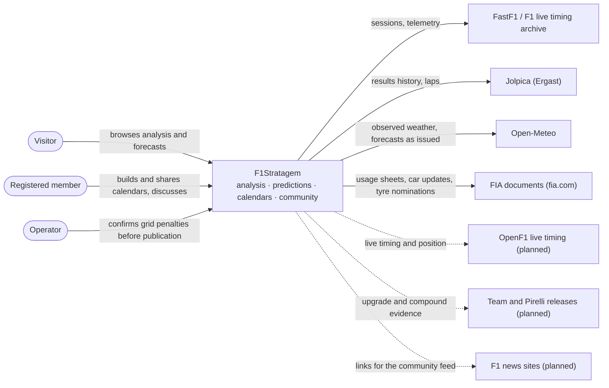

---

## System overview

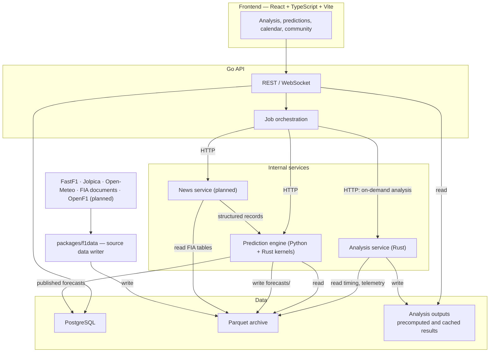

| Component | Location | Responsibility |
|---|---|---|
| Frontend | `frontend/` | UI, charts, 3D track and globe, calendar builder, community |
| API | `api/` | Public HTTP/WebSocket API, Postgres access, caching, job orchestration, auth |
| Analysis service | `services/analysis/` | Rust. The only reader of raw timing and telemetry for the website: lap and telemetry maths, precompute after each session, on-demand requests over HTTP |
| Prediction engine | `services/predictor/` | Probabilistic forecasts, championship simulation, forecast ledger. No user state. |
| News service | `services/news/` | Team and Pirelli releases, selected outlets; structured upgrade records |
| Data archive | `packages/f1data/` | Sole writer of the archive's source data: collection, extraction, verification, readers |

The Go API is the only public entry point. The services are internal and are
called over HTTP with typed contracts. The API never reads the raw archive: it
reads Postgres and the analysis outputs, adds caching, auth and rate limits, and
forwards on-demand requests to the analysis service. Published forecasts reach the
API through Postgres; the frozen ledger files stay the prediction engine's.

Analysis outputs are their own dataset with one writer, the analysis service.
They are kept apart from the archive (never inside `data/` source datasets), and
every cached result is keyed by the version of the session data it was computed
from, so a re-ingested session invalidates its results.

---

## Deployment

Production target. One small VPS (1 vCPU / 2 GB is workable, 2 vCPU / 4 GB
comfortable, swap for memory spikes) runs the server side with Docker Compose or
system services. Only the HTTPS front is reachable from the internet; the API and
the analysis service talk over plain HTTP on the machine's private network (TLS
ends at the front). Because the services talk over HTTP, any of them can move to
its own machine later without code changes.

- **On the VPS:** an HTTPS front (Caddy or nginx), the Go API, the Rust analysis
  service, PostgreSQL (tuned small, or a managed database), the session Parquet
  files (about 22 GB) with the reference and results tables, the analysis outputs,
  and a scheduled precompute after each upload. Disk: a 40–80 GB SSD covers
  several seasons; object storage (S3 or R2) also works with the same layout, but
  reads are slower.
- **On a CDN** (Cloudflare Pages or Netlify): the frontend's static files, and
  precomputed analysis files where they can be served as static files.
- **Off the server:** predictor training, evaluation and forecast publishing, and
  `f1data` ingestion run on the developer PC or a short-lived cloud machine, which
  uploads new session files and frozen forecasts. Live in-race forecasting is a
  later phase and needs a stronger, always-on machine.
- **Never deployed:** the FastF1 download cache (`fastf1_http_cache.sqlite`, 11.5 GB,
  needed only to rebuild the archive; kept at home with a backup) and the FIA PDFs
  (private, for licensing reasons).

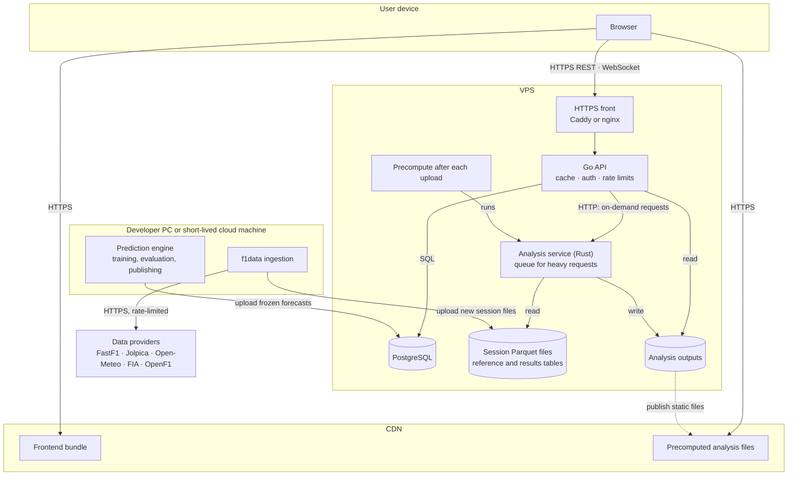

Local development: every process runs on one machine and the archive is the
repository's `data/` directory.

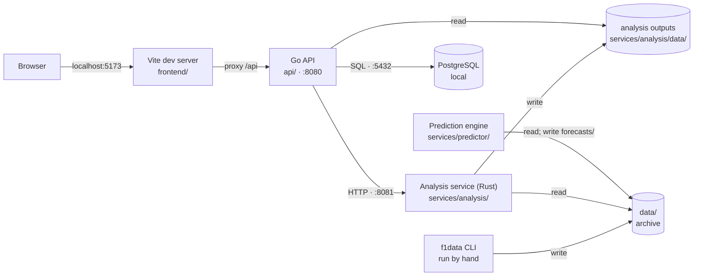

---

## Repository layout

```
F1Stratagem/
├── frontend/                 React + TypeScript + Vite + Bun
├── api/                      Go API (cmd/, internal/, migrations/)
├── services/
│   ├── analysis/             Rust analysis service (Cargo crate); outputs and cache in data/ (git-ignored)
│   ├── predictor/            Prediction engine (pace model, race model, evaluation; Rust in kernels/pace, kernels/race)
│   └── news/                 News and upgrade service (planned)
├── packages/
│   └── f1data/               Archive collection, verification and readers; CLI `f1data`
├── contracts/                Service request/response schemas (added with the first contract)
├── design/                   Subsystem design documents
├── data/                     The archive (git-ignored)
├── Architecture.md
├── DataUsePlan.md            Catalogue of metrics and views
└── Makefile
```

- Each archive dataset has exactly one writer. `packages/f1data` writes all source
  data; the prediction engine writes only `data/forecasts/`, append-only. Every
  other service only reads. Services import `f1data`'s readers. Services keep their own caches under
  `services/<name>/data/`.
- `contracts/` holds JSON Schemas for every service endpoint. Go types and
  Pydantic models are tested against them, replacing the untyped
  `map[string]interface{}` responses in `api/internal/worker`.
- Each service and package has its own dependencies and is built and deployed
  alone. FastF1 is pinned to 3.9.0 everywhere, the version the archive was written
  with.
- Configuration comes from the repository's `.env` (see `.env.example`). The data
  root defaults to `<repository>/data`; `F1_DATA_ROOT` overrides it.

### Current state

- The analysis service restarted as a Rust crate that reads the archive (team race
  pace from a race's own laps is in place, command line only); the old Python worker
  was deleted. Its HTTP server, precompute and track-map endpoint are not built yet.
- The API's `GET /sessions/{id}/telemetry` route, used by the track map
  (ComparePage, InteractiveTrack3D: up to 4 drivers, one lap each), has nothing to
  call until then. It will not be restored: the analysis service's track-map
  endpoint replaces it. A whole-race track-map mode does not exist yet.
- Migration `001_core_schema` stores laps, stints and weather in Postgres. These
  are served from the archive instead; Postgres keeps reference tables.
- The frontend and API predate the archive and prediction design and are being
  rebuilt around it.
- The prediction engine forecasts qualifying and races from the archive and is
  evaluated walk-forward; it does not serve forecasts over HTTP yet.

---

## Data

The archive holds 2018–2026 FastF1 sessions (958 of 981 complete; the 23 gaps are
missing upstream and listed in `data/missed-sessions.json`), Jolpica history from
1950, Open-Meteo weather for every race weekend since 1950 including forecasts as
issued, and FIA documents from 2019 with parsed PU and gearbox usage, car updates
and Pirelli nominations: 37 GB, growing 3–4 GB per season. Layout, integrity
rules, extraction and time semantics: [design/data-archive.md](design/data-archive.md).

```
f1data verify          re-hash every file of every source
f1data fastf1 ingest   new sessions (after each event)
f1data fia download    new documents
```

Commands and rebuild instructions: [packages/f1data/README.md](packages/f1data/README.md).

### Licences

Before any commercial launch: Jolpica data is CC BY-NC-SA (needs permission);
Open-Meteo's free API is non-commercial (paid plan or self-hosting); FIA documents
are all rights reserved (kept private, linked to fia.com; needs consent); FOM
timing data display rights.

### PostgreSQL

Holds data that user content joins to or that the API serves transactionally:

- Reference: `seasons`, `circuits`, `circuit_layouts`, `events`, `sessions`,
  `drivers`, `teams`, `team_seasons`, `driver_seasons`, `regulation_eras`.
- Operations: `ingestion_jobs`.
- Users and community: `users`, `user_search_history`, `calendar_posts`,
  `calendar_entries`, `calendar_rotations`, `calendar_variants`.
- Predictions: `forecast_index` (event, cutoff, model version, archive path) for
  listing; forecast payloads stay in the archive.

Postgres `sessions` rows carry the archive session ID (`<year>-<round>-<slot>`).
Canonical IDs for drivers, teams and circuit layouts are shared by Postgres, the
archive, the prediction engine and the calendar builder. A layout change (new
chicane, reprofiled corner) creates a new layout ID under the same circuit.

Target schema. Migration `001_core_schema` still differs (it also holds laps,
stints, weather and session results); attributes are shown only where the DDL
below defines them.

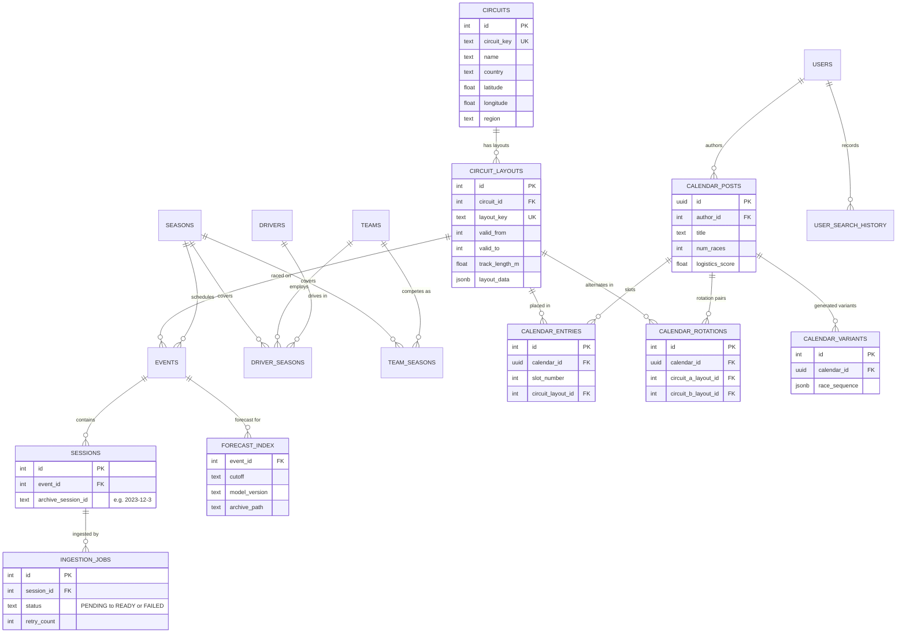

```sql
CREATE TABLE circuits (
    id              SERIAL PRIMARY KEY,
    circuit_key     TEXT UNIQUE NOT NULL,      -- "monza"
    name            TEXT NOT NULL,
    country         TEXT NOT NULL,
    city            TEXT,
    latitude        DOUBLE PRECISION,
    longitude       DOUBLE PRECISION,
    altitude_m      DOUBLE PRECISION,
    region          TEXT,                      -- calendar logistics
    first_gp_year   INT
);

CREATE TABLE circuit_layouts (
    id              SERIAL PRIMARY KEY,
    circuit_id      INT REFERENCES circuits(id),
    layout_key      TEXT UNIQUE NOT NULL,      -- "monza-2000"
    valid_from      INT NOT NULL,              -- year
    valid_to        INT,                       -- NULL = current
    track_length_m  DOUBLE PRECISION,
    num_corners     INT,
    layout_data     JSONB                      -- corner positions, sectors, DRS zones
);

CREATE TABLE ingestion_jobs (
    id              SERIAL PRIMARY KEY,
    session_id      INT REFERENCES sessions(id),
    status          TEXT NOT NULL DEFAULT 'PENDING',
    -- PENDING → DOWNLOADING → PROCESSING → READY | FAILED
    requested_by    TEXT,
    error_message   TEXT,
    retry_count     INT DEFAULT 0,
    source_version  TEXT,
    processing_version TEXT,
    created_at      TIMESTAMPTZ DEFAULT now(),
    updated_at      TIMESTAMPTZ DEFAULT now()
);

CREATE UNIQUE INDEX idx_ingestion_active
    ON ingestion_jobs(session_id)
    WHERE status IN ('PENDING', 'DOWNLOADING', 'PROCESSING');

CREATE TABLE regulation_eras (
    id              SERIAL PRIMARY KEY,
    name            TEXT NOT NULL,             -- "Ground effect 2022"
    era_type        TEXT NOT NULL,             -- technical, tyre, aero, sporting
    year_start      INT NOT NULL,
    year_end        INT,
    key_changes     JSONB
);
```

Calendar builder tables:

```sql
CREATE TABLE calendar_posts (
    id              UUID PRIMARY KEY DEFAULT gen_random_uuid(),
    author_id       INT REFERENCES users(id),
    title           TEXT NOT NULL,
    description     TEXT,
    is_featured     BOOLEAN DEFAULT false,
    is_published    BOOLEAN DEFAULT false,
    num_races       INT NOT NULL,              -- 16–24
    calendar_rules  JSONB,
    logistics_score DOUBLE PRECISION,
    total_distance_km DOUBLE PRECISION,
    created_at      TIMESTAMPTZ DEFAULT now(),
    updated_at      TIMESTAMPTZ DEFAULT now()
);

CREATE TABLE calendar_entries (
    id              SERIAL PRIMARY KEY,
    calendar_id     UUID REFERENCES calendar_posts(id) ON DELETE CASCADE,
    slot_number     INT NOT NULL,
    circuit_layout_id INT REFERENCES circuit_layouts(id),
    is_permanent    BOOLEAN DEFAULT true,
    scheduled_month INT,
    scheduled_week  INT
);

CREATE TABLE calendar_rotations (            -- e.g. Spa / Hockenheim
    id              SERIAL PRIMARY KEY,
    calendar_id     UUID REFERENCES calendar_posts(id) ON DELETE CASCADE,
    slot_number     INT NOT NULL,
    circuit_a_layout_id INT REFERENCES circuit_layouts(id),
    circuit_b_layout_id INT REFERENCES circuit_layouts(id),
    geo_distance_km DOUBLE PRECISION
);

CREATE TABLE calendar_variants (             -- generated when rotations change logistics
    id              SERIAL PRIMARY KEY,
    calendar_id     UUID REFERENCES calendar_posts(id) ON DELETE CASCADE,
    variant_label   TEXT NOT NULL,
    race_sequence   JSONB NOT NULL,
    total_distance_km DOUBLE PRECISION,
    logistics_score DOUBLE PRECISION
);
```

---

## Ingestion

- **Scheduled.** `f1data` runs after every session and as a backfill command.
  Reruns resume: verified files are skipped and cached responses reused. Each
  source respects its provider's rate limit across restarts.
- **Missing sessions.** The API never downloads inside a request. A request for a
  session not yet archived inserts an `ingestion_jobs` row (the partial unique
  index deduplicates concurrent requests) and returns `202`; the ingestion runner
  claims pending jobs; the client follows `/ws/ingestion/{job_id}`. With the
  archive complete from 2018, this covers only sessions newer than the last run.
- **Live capture (planned).** OpenF1 data is stored as provisional with receipt
  times; the FastF1 version is loaded as authoritative after the session; both are
  kept and reconciled.

Ingestion job lifecycle. The partial unique index allows one active job per
session.

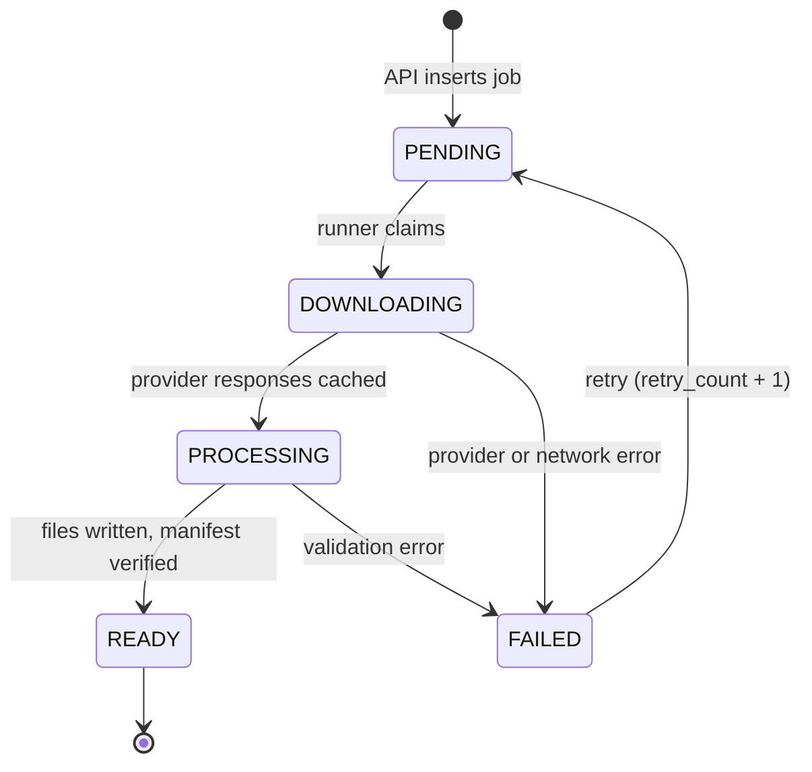

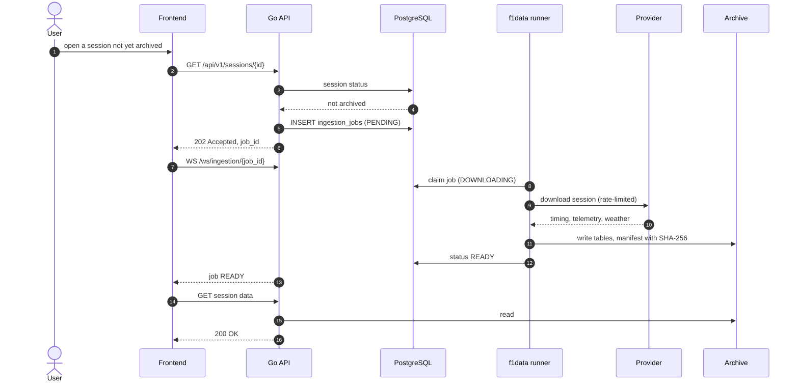

---

## Request flows

Session analysis (target; see [Current state](#current-state)). What most visitors
open is precomputed after each session and read from the analysis outputs (or the
CDN); anything else is computed by the analysis service on request and cached.

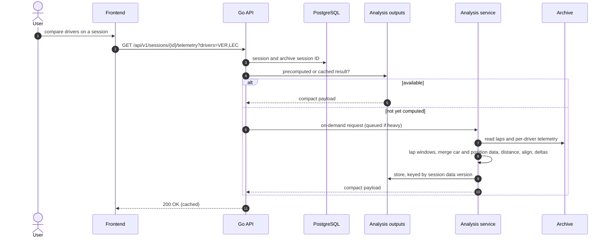

Forecast publication at a cutoff (after a practice session, after qualifying,
and so on). Penalty confirmation applies to upcoming events only, never to
backtests.

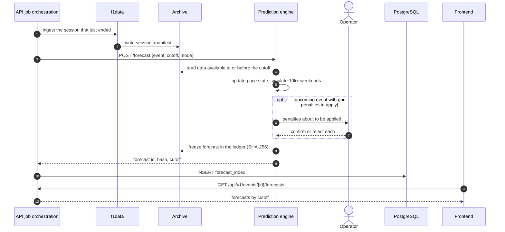

Championship on a user-built calendar. Results are cached per calendar so
identical calendars share one simulation; calendar dates use climatology, not
forecasts.

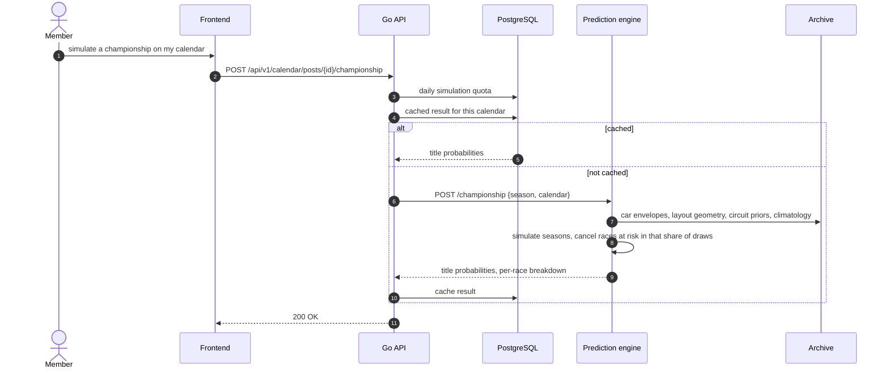

Live race forecast (planned). The pre-race and live forecasts are the same race
simulator, started from lap 0 or from the observed race state.

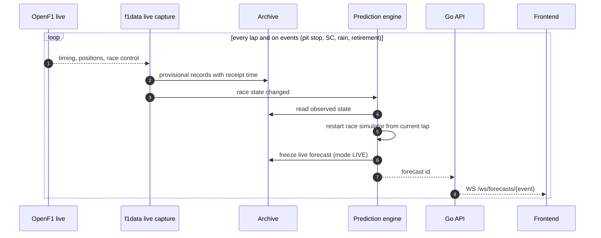

### Open decisions

- **Scheduler.** Cutoff-triggered jobs are drawn under the API's job
  orchestration; a separate scheduler process is the alternative.

---

## Prediction engine

Forecasts for every entrant in qualifying (including sprint grid sessions),
sprint and Grand Prix: full position distributions, pole probability and 80%
intervals, five-way race outcomes, expected points, and championship
probabilities rerun after every race for the real calendar and for calendars built
by users. All quantities come from one joint simulation per event, so they are
consistent by construction. Every published forecast is frozen and hashed in the
forecast ledger before its session starts. Grid penalties the model is about to
apply to an upcoming race are confirmed by an operator before publication.

The engine is one Python service. Its hot loops are Rust extension modules that
the service imports like any Python package: the pace model's Kalman filter
(`predictor_native`) and the race simulation (`predictor_race_native`).
They run in the service's process, so the deployment diagrams show the service
only; the Go API sees only the service.

Design, components (pace model, car envelope and lap simulator, run
classification, learned race events, weather scenarios, grid penalties, tyre
strategy, simulators) and evaluation: [design/prediction-engine.md](design/prediction-engine.md).

---

## News

Two separate paths:

- **Model evidence** (`services/news`): team and Pirelli releases and selected
  outlets, deduplicated and extracted into structured, timestamped records. FIA
  documents are collected by the archive, not by this service. See
  [design/news-intelligence.md](design/news-intelligence.md).
- **Community feed** (community phase): an hourly scraper listing all F1 news as
  headline, source, time and link (never republished), each with a discussion
  thread. Unrelated to the model.

---

## API

Implemented routes (`api/internal/server/server.go`):

```
GET  /health
GET  /api/v1/seasons
GET  /api/v1/seasons/{year}
POST /api/v1/seasons/{year}/sync
GET  /api/v1/seasons/{year}/events
GET  /api/v1/events/{eventId}/sessions
GET  /api/v1/sessions/{sessionId}
GET  /api/v1/sessions/{sessionId}/results
GET  /api/v1/sessions/{sessionId}/laps
GET  /api/v1/sessions/{sessionId}/stints
GET  /api/v1/sessions/{sessionId}/weather
GET  /api/v1/sessions/{sessionId}/telemetry
POST /api/v1/sessions/{sessionId}/ingest
GET  /api/v1/sessions/{sessionId}/ingest/status
GET  /api/v1/drivers
GET  /api/v1/teams
GET  /api/v1/circuits
```

Planned:

```
GET  /api/v1/drivers/{code}                     driver profile
GET  /api/v1/teams/{key}                        team and car profile
GET  /api/v1/circuits/{key}                     circuit profile, corner classes, regime mix
GET  /api/v1/events/{eventId}/forecasts         forecasts for the event, by cutoff
GET  /api/v1/forecasts/{forecastId}             full forecast payload
GET  /api/v1/forecasts/{forecastId}/review      post-race attribution
GET  /api/v1/seasons/{year}/championship        title probabilities and their history
GET  /api/v1/ledger                             frozen forecasts, hashes, track record
WS   /ws/forecasts/{eventId}                    live forecast updates
WS   /ws/ingestion/{jobId}                      ingestion progress
GET  /api/v1/news                               verified news

Phase 4
POST /api/v1/auth/register, /auth/login; GET /auth/me
GET|POST /api/v1/user/history
GET|POST /api/v1/calendar/posts; GET|PUT /calendar/posts/{id}
GET  /api/v1/calendar/circuits
POST /api/v1/calendar/logistics
POST /api/v1/calendar/posts/{id}/championship   simulate a season on this calendar
GET  /api/v1/community/news                     community news feed and threads
```

Internal service endpoints:

```
analysis   (planned, Rust; replaces the old Python worker's routes)
           GET  /health
           POST /telemetry/compare   track map and traces: up to 4 drivers, one lap each
           POST /precompute          {session} → precomputed results after an upload
           (race pace, whole-race replay and the rest added with their features)
predictor  GET  /health
           POST /forecast            {event, cutoff, mode} → forecast
           POST /replay              {event, from_lap}     → stream of forecasts
           POST /championship        {season, calendar?}   → title probabilities
           GET  /models/current      model version, training data fingerprint
```

---

## Frontend

React 19, strict TypeScript, Vite, Bun, Tailwind CSS v4, React Router 7, Apache
ECharts, Three.js / React Three Fiber. No Next.js. The current pages (session
browser, multi-driver telemetry comparison, 3D track) are being rebuilt around the
archive, predictions and community features.

```
/, /season/:year          home, season browser
/session/:id              session analysis
/compare/:sessionId       telemetry comparison (up to 4 drivers)
/races/:year/:round       race analysis
/standings                championship standings
/drivers/:code            driver profile
/teams/:key               team and car profile
/circuits/:key            circuit profile
/predictions/:event       forecasts by cutoff, intervals, live view
/championship/:year       title probabilities through the season
/ledger                   forecast track record
/news                     verified news
/calendar, /calendar/create, /calendar/:id
/community                community feed and discussions
```

---

## Roadmap

| Phase | Focus |
|---|---|
| 1 | Core analysis: session browser, telemetry comparison (in place, to be rebuilt) |
| 1b | Monorepo and shared archive, canonical driver, team, circuit and lineage IDs (done); analysis on archive reads; typed contracts |
| 2 | (In progress: race model; qualifying pace model in place) Prediction engine, built one feature at a time: pace model, circuit and car profiles, envelope and lap simulator, qualifying and race simulators; forecasts published per cutoff; forecast ledger; championship forecast after every race |
| 3 | Deep analytics: driver, car and circuit profiles, sharing the prediction engine's profile pipeline (corner classes, track mixes, car profiles) |
| 4 | Calendar builder, accounts, community sharing and news feed; championship simulation on user calendars |
| 5 | Replay and live forecasting; news service |
| 6 | Strategy tools, scenario simulation, career priors |

---

## Verification

- `go test ./...` for the API; `pytest` per Python package and service.
- `f1data verify`: checksum audit of every archived file.
- Contract tests: Go and Python payloads validated against `contracts/` schemas.
- Prediction engine: walk-forward evaluation and consistency checks (probability
  sums, monotonic derived quantities) on every model version.
