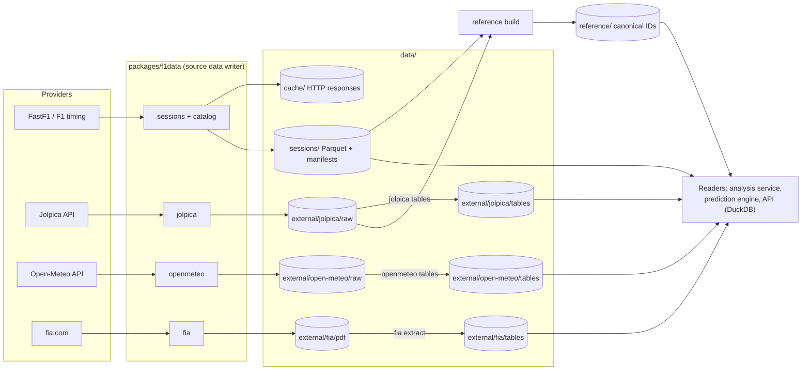
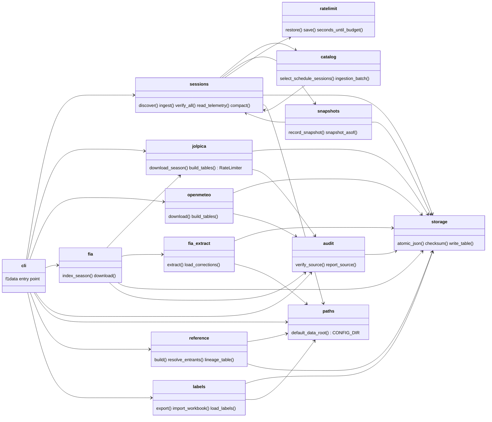
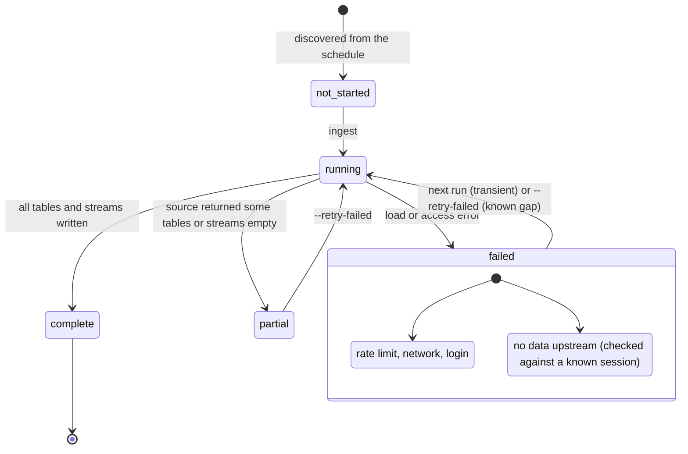
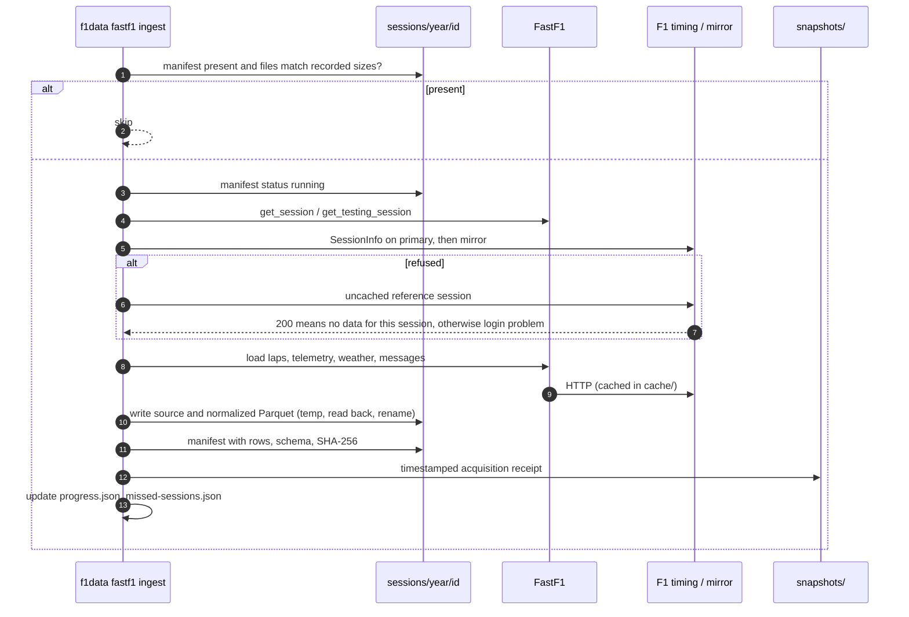

# Data archive

A local archive of F1 timing, telemetry, results, weather and official documents.
Each dataset in it has exactly one writer: the ingestion pipeline (`f1data`)
writes source data, the prediction engine writes the forecast ledger; every other
service only reads. FastF1 access requires an F1TV subscription since October 2026, so the
archive is the long-term source of record for historical data.

## Storage roles

| Store | Holds | Why |
|---|---|---|
| Parquet + DuckDB | Laps, results, weather, track status, race control, telemetry, documents, derived features | Columnar, compressed, scanned by column and partition; no server |
| PostgreSQL | Users, calendars, community content; small reference tables (drivers, teams, circuits, events) | Relational joins with user content |
| Object storage (later) | Same Parquet layout for deployment and backups | DuckDB reads it directly |

SQLite was rejected for telemetry: row storage, weak compression and slow column
scans at hundreds of millions of rows.

## Sources

| Source | Coverage | Contents | Licence / access |
|---|---|---|---|
| FastF1 | 2018–2026, all sessions incl. testing | Laps, results, weather, track and session status, race control, car and position telemetry | F1TV account; client limit 500 calls/h |
| Jolpica (Ergast successor) | 1950–2026 | Races, results, qualifying (1994+), sprints, standings, pit stops (2011+), lap times (1996–2018) | CC BY-NC-SA 4.0 |
| Open-Meteo | 1950–2026 race weekends | Observed hourly weather (reanalysis); forecasts as issued 0–7 days ahead (2024+, temperature 2021+) | CC BY 4.0 data; free API non-commercial |
| FIA documents | 2019–2026 | PU and gearbox usage, car presentation (upgrade) sheets, Pirelli previews, decisions, grids, entry lists, technical reports | All rights reserved; private copies, link to fia.com |
| OpenF1 (planned) | 2023+, live | Live timing and position | Terms to verify |

Sessions that F1's archive lost in its 2024 server migration (most of 2022) are
served by the FastF1 mirror (`livetiming-mirror.fastf1.dev`); the access check
probes it before treating a session as unavailable.



## Layout

```
data/
  cache/fastf1_http_cache.sqlite        raw FastF1 responses (replayable offline)
  sessions/<year>/<session-id>/
    manifest.json                       status, files, row counts, SHA-256, errors
    source/<table>.parquet              FastF1-processed tables, provider columns unchanged
    normalized/<table>.parquet          core tables + session metadata columns
    source/{car_data,pos_data}/driver-<n>.parquet   telemetry, one copy
  missed-sessions.json                  sessions the source cannot supply, with reason
  progress.json, inventory.json         session ledger
  rate-limit-state.json                 FastF1 call window, kept across restarts
  logs/                                 download logs
  reference/                            canonical events, sessions, entrants, drivers, teams, circuits
  labels/                               labelling workbooks (filled by hand; imported into config)
  forecasts/                            forecast ledger, append-only (written by the prediction engine)
  legacy/                               feasibility-pilot outputs, kept for reference
  external/
    jolpica/raw/<season>/...            API pages unchanged; manifest per season
    jolpica/tables/*.parquet            rebuilt from raw
    open-meteo/raw/<dataset>/<season>/  API responses unchanged; manifest.json
    open-meteo/tables/*.parquet         observed_hourly, forecast_runs_hourly (long)
    fia/index/<season>.json             every listed document: event, number, title, category, time
    fia/pdf/<season>/<event>/doc-NNN-<title>.pdf
    fia/tables/*.parquet                pu_usage, rnc_usage, car_updates, tyre_nominations
```

- Session ID: `<year>-<round>-<slot>` (`2023-12-3`); testing `<year>-T<n>-<slot>`.
- Core tables: `laps`, `results`, `weather`, `track_status`, `session_status`,
  `race_control`. Telemetry is re-joined to session and driver columns on read.
- FastF1's parsed pickle cache is disabled; it duplicates `source/` and can be
  rebuilt offline from the HTTP cache.
- FIA publication times are shown in Paris local time and stored as UTC.

Package structure of `packages/f1data`. Arrows are imports; `storage` holds the
atomic-write and checksum primitives every source uses.



## Integrity

- Writes go to a temporary file and are atomically renamed. Every file is listed in
  a manifest with its SHA-256; a full audit (`f1data verify`) re-hashes every
  source and reports files that no manifest lists.
- One writer per dataset. `f1data` alone writes source data, and two ingestion
  processes must never share a data root. The prediction engine alone writes
  `forecasts/`, only adding files, never changing them.
- A session is skipped on rerun only if every recorded file is present.
- Failures the source cannot fix (cancelled sessions, empty feeds) are recorded in
  `missed-sessions.json` and skipped; one `--retry-failed` pass is run after a full
  download. Failures on our side (rate limit, network, login) are always retried.
- Rate limits are respected per source and persisted across restarts: FastF1 by its
  own window, Jolpica at ≤ 400 requests/h, Open-Meteo by weighted call count,
  fia.com at the robots.txt crawl delay of 10 s.
- Extracted tables keep provenance per row: source file, SHA-256, document number,
  publication time, page.

FastF1 session manifest states. Only `complete` sessions are skipped as done;
known gaps are skipped until a `--retry-failed` pass.



Ingesting one FastF1 session.



## Reference tables

`f1data reference build` derives canonical identifiers from the archive. Driver,
constructor and circuit IDs follow the Ergast scheme (`max_verstappen`, `red_bull`,
`bahrain`) that Jolpica, FastF1 and the platform database share; FastF1 and
Jolpica round numbers agree for every season.

| Table | Contents |
|---|---|
| `events` | Championship rounds and pre-season tests: format, location, circuit ID, race date |
| `sessions` | Every archived session: type, scheduled start, actual first lap start and last lap end (UTC) |
| `entrants` | Every car in every session with its driver, constructor and lineage ID and how each ID was resolved |
| `teams` | Constructor ID, name and lineage per season, 1996 onward |
| `drivers`, `circuits` | Jolpica records |

FastF1 leaves IDs blank for most testing and some practice and sprint qualifying
sessions. They are filled from the same car in the same event, then from the same
car number and abbreviation in the season, then from the same full name in
another season; an ID is filled only when exactly one candidate exists. Drivers
who only ran in practice and never started a race keep an empty driver ID; their
team is still resolved. The manifest lists every unresolved entrant.

**Team lineage.** `config/team-lineage.json` groups constructor IDs into lineages,
one racing team through its renames, keyed by factory base: for example
`faenza` covers Minardi, Toro Rosso, AlphaTauri and RB, and `enstone` covers
Benetton, Renault, Lotus and Alpine. Every constructor-season since 1996 maps to
exactly one lineage; the build fails otherwise, so a new team or rename needs the
config updated first.

**Hand-reviewed labels.** From 2023 the timing sources record almost every
retirement only as "Retired". `f1data labels export` writes a workbook of every
race and sprint retirement, prefilled from the archive, with a cause column
(mechanical, driver error, collision at fault / victim / racing incident, damage,
team error, withdrawal, other), plus a sheet of finishers whose result suggests a
hidden problem. After review, `f1data labels import` merges the reviewed rows into
`config/race-incident-labels.json`, keyed by session and car, with the source of
each label. They are target labels only, never pre-race features. 2023–2024 are
complete (101 retirements, 83 checked finishes).

## Document extraction

FIA PDFs are text-based; each document type has its own parser, and every parser
checks what it reads.

| Table | Seasons | Checks |
|---|---|---|
| `pu_usage` (elements introduced per driver) | 2019–2026 | full driver list per sheet; element names stable within a season |
| `rnc_usage` (gearbox case, driveline) | 2022–2024 | as above; sheets not published outside these years |
| `car_updates` (component, reason, geometry, description) | 2024–2026 | every team covered at every event |
| `tyre_nominations` (C1–C6, minimum pressures, camber) | 2022–2026 | three compounds per event; pressures 2022–2025 (2026 sheets use a new layout, not yet parsed); no preview published for 2022 Bahrain and 2025 São Paulo |

- Car presentation tables are read from the drawn row dividers and column borders,
  not from text order, so merged cells and missing dividers are handled.
- Values are kept as published. Source errors (a missing car number, a count that
  drops between sheets) are flagged, not corrected.
- Pages without a text layer are entered by hand in `packages/f1data/src/f1data/config/fia-corrections.json`
  with how they were read; they are applied on top of parsed data.

## Archive state

| Source | Size | Gaps |
|---|---:|---|
| FastF1 sessions + HTTP cache | 22 GB + 11.5 GB | 958 of 981 sessions complete. Permanent: 6 sessions without laps (2018 Italian GP race, five sessions cancelled for weather), 17 with some telemetry streams missing upstream |
| Jolpica | 69 MB | No qualifying before 1994; 2018 Italian GP race laps come from here |
| Open-Meteo | 47 MB | Final weekends of the current season until reanalysis settles |
| FIA | 2 GB | Upgrade sheets only from 2024; Pirelli previews from 2022 |

Growth: roughly 3–4 GB per season.

## Time semantics

Each record carries an event time and, where known, an availability time.
Historical archive data lacks verified availability times, so backtests on it run
in `archive_proxy` mode and are labelled retrospective. Data captured live from
go-live onward supports strict backtests. FIA documents and forecast-run weather
carry publication or issue times and are usable as of their cutoff.

## Live capture and reconciliation (planned)

During a session, OpenF1 data is stored as provisional with its receipt time.
After the session the FastF1 version is loaded as authoritative. Both are kept; a
reconciliation step diffs them and flags mismatches instead of overwriting.

## Open items

- Circuit layout versions (a reprofiled track as a new layout). FIA event and
  driver names are mapped when the penalty model needs them.
- Parsers for stewards' decisions, starting grids and the per-event "new PU
  elements" / "new gearboxes" notices (downloaded, not yet parsed), and for the
  2026 Pirelli pressure table.
- Data rights before a commercial launch: Jolpica (non-commercial licence),
  Open-Meteo (paid plan or self-hosting), FIA (written consent), FOM timing data.
