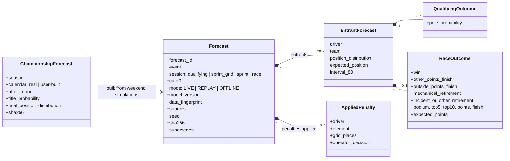
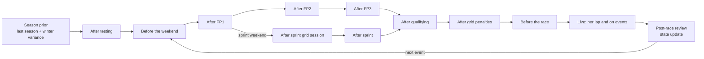
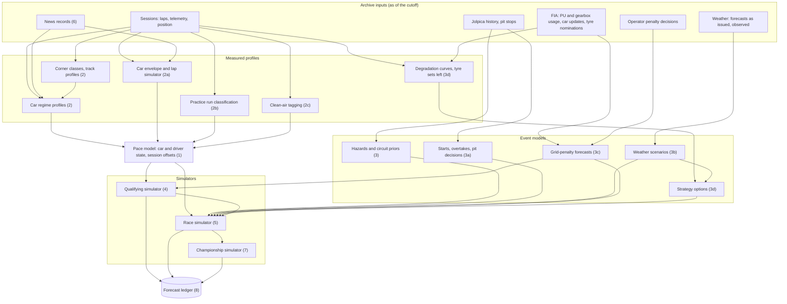
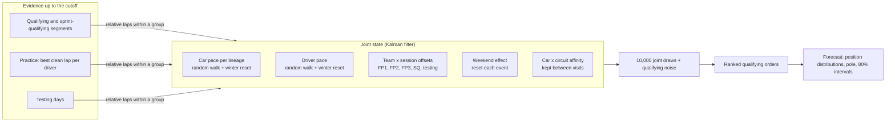
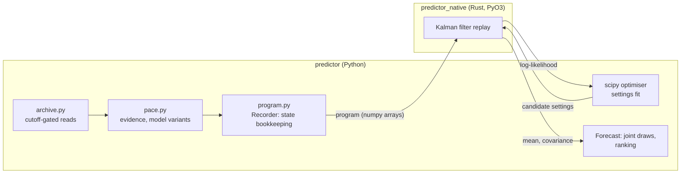
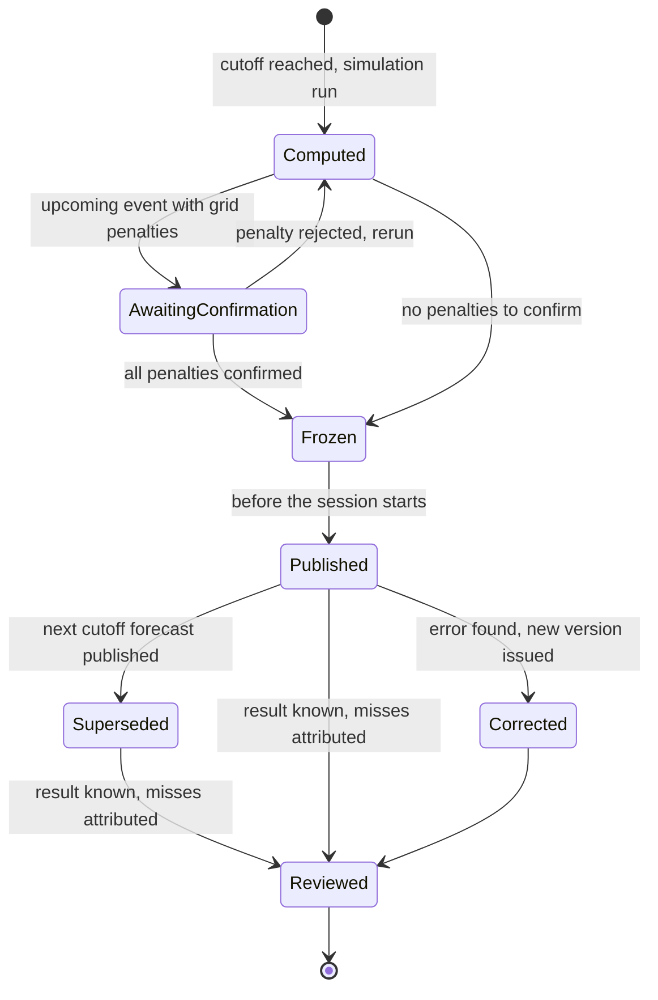
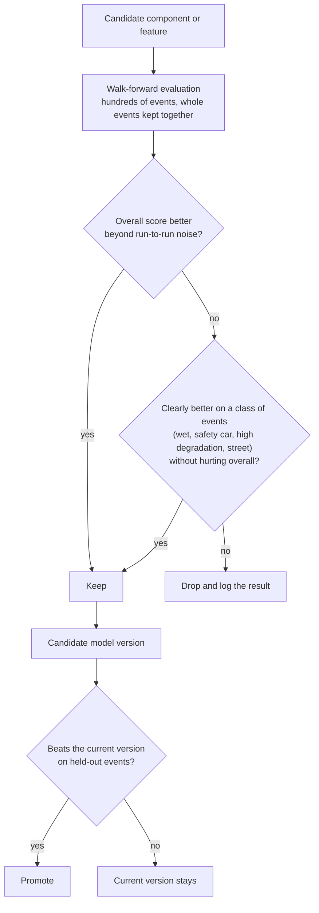

# Prediction engine

The prediction engine produces probabilistic forecasts for every entrant of an F1
weekend: qualifying (including sprint grid sessions), sprint and Grand Prix. It runs
as a Python service called by the platform's Go API; it holds no user state.

## Status

| Component | State |
|---|---|
| Data archive (FastF1, Jolpica, Open-Meteo, FIA documents), see [data-archive.md](data-archive.md) | Implemented |
| Cutoff-gated archive access, targets, forecast object, baselines, walk-forward evaluation | Implemented |
| Pace model for qualifying: car, driver, team × session offsets, weekend effect, winter reset | Implemented (v3w) |
| Corrected race pace as evidence (tyres, tyre age, fuel lap by lap) | Implemented, current model at both cutoffs (v3wr) |
| Native Kalman filter (Rust, PyO3): weighted observations, per-group estimation covariance | Implemented |
| Fit cache (fits reused across cutoffs and runs) and quick screens | Implemented |
| Track profiles from telemetry, circuit layout table | Implemented |
| Practice run classification (push laps, long runs) | Implemented; push pace with its own noise (v3wrpn) is the last-cutoff challenger |
| Race pace estimation uncertainty in the filter (v3wru) | In evaluation |
| Qualifying history 1996–2017, driver season form, car × circuit affinity, driver corner skills | Tested, not adopted (see Training and evaluation) |
| Retirement causes for 2023–2024 from reviewed race reports | Implemented |
| Pace model for races, circuit/car profiles, hazards | Planned |
| Car performance envelope and lap simulator | Planned |
| Practice run classification, clean-air tagging | Planned |
| Learned race events, weather scenarios, grid-penalty forecasts, tyre strategy | Planned |
| Qualifying and race simulators | Planned |
| Championship simulation (real and user-built calendars) | Planned |
| Forecast ledger | Planned |
| Live replay and live inference | Planned |

## Outputs

Per entrant, per forecast:

- Full finishing-position distribution and expected position.
- Qualifying: pole probability, position distribution, central 80% interval (e.g. P3–P7).
- Race: five-way primary outcome — `win`, `other_points_finish`,
  `outside_points_finish`, `mechanical_retirement`, `incident_or_other_retirement`
  — summing to 1. DNS/DSQ are explicit exclusions, not forced into a category.
- Podium, top-5, top-10, points and finish probabilities; expected points under
  that season's points rules.
- Championship: drivers' and constructors' title and final-position
  probabilities, for the real calendar and for calendars built by users.

All quantities are derived from one joint simulation per event, so they are
consistent by construction: one winner per simulated race, win ≤ podium, grid-wide
win probabilities sum to 1, each position column sums to 1.

Every forecast records its cutoff, the sources it used, model version, data
freshness and mode (`LIVE`, `REPLAY`, `OFFLINE`).

Logical output model (field names indicative):



## Forecast cutoffs

Before the weekend, after pre-season testing, after each practice session, after
sprint grid session and sprint, after qualifying, after published grid penalties,
before the race, and live (per lap and on events: pit stops, SC/VSC, red flags,
rain, incidents, penalties). A forecast may only read data whose availability time
is at or before its cutoff.



## Components

Data flow through the components below (section numbers in brackets):



### 1. Pace model

Lap time is decomposed into additive effects:

```
lap_time = session/track + car(team, t) + driver(t) + compound × tyre_age
         + fuel (lap-number proxy) + track_evolution + traffic + noise
```

**Implemented for qualifying (`pace.py`).** Pace is log lap time × 100 (about
percent of a lap; lower is faster). A driver's pace in a session is

```
car(lineage, t) + driver(t) + offset(lineage, session type)
    + weekend(lineage, event) + affinity(lineage, circuit) + noise(session type)
```

- **States.** A Kalman filter carries all states jointly. Car (per team lineage)
  and driver are random walks whose variance grows with days elapsed. Teammates
  share the car state, which separates car from driver.
- **Evidence.** Qualifying and sprint-qualifying segments, each practice
  session's best clean lap per driver, and testing days. Every driver is compared
  with a reference driver in the same segment or session, so track evolution
  between segments does not leak in; laps beyond 107% of the group's best are
  dropped. Qualifying is the reference session type; every other type has its own
  noise and a per-lineage offset with a zero-mean prior (a team flattered by its
  practice running gets a negative offset only as far as the data supports it).
- **Weekend effect.** Each lineage has an effect shared by every session of one
  event and reset at the next. It holds track-specific and one-off swings (setup,
  conditions, upgrades), so they do not move long-run pace. Before the weekend it
  is unknown (prior spread, shared by teammates); after practice it carries what
  the weekend's practice showed into the same weekend's qualifying.
- **Car × circuit affinity (tested, not adopted).** A persistent per-circuit effect for
  each lineage, kept between visits. Its variance grows with time and at each
  season start, multiplied at regulation changes; its value is kept, so recent
  visits weigh more and an earlier regulation era still counts. Only the current
  circuit's affinities are active in the joint state; others are parked with mean
  and variance and resume with the variance accrued while parked.
- **Winter reset.** Each season start adds variance to cars and drivers, multiplied
  for cars in seasons that begin under new technical regulations (2014, 2017, 2022,
  2026). Early-season sessions therefore move estimates a lot and mid-season ones
  little; there is no hand-set "after race N" switch.
- **Settings.** Noise levels, drift rates, prior spreads, winter terms and the
  regulation multiplier are fitted by maximum one-step predictive likelihood on
  sessions available before each evaluated season. A setting is fitted only when
  the data can identify it (offsets only with non-qualifying evidence; the
  regulation multiplier only once the data crosses a regulation change; affinity
  only once the data spans two seasons, so circuits have been revisited).
- **Fitting.** Fit quality matters more than run time. Settings are fitted as
  logs within bounds. Each round runs Powell, then L-BFGS-B and adaptive
  Nelder-Mead from the best point so far, and rounds repeat until one gains less
  than 0.01 in log-likelihood; methods stall in different places, so alternating
  them escapes false optima. Fits start from the previous season's settings and
  from defaults; a model that extends another (v3wa extends v3w) also starts from
  the smaller model's optimum with the extra terms barely on, so its fit can
  never end below the model it extends. Every fit records its convergence,
  evaluations and the log-likelihood reached from each start.
- **Forecast.** States are drawn jointly from the posterior (10,000 draws) with
  qualifying noise added, and each draw is ranked.



Lessons from development:

- Adding practice without a weekend effect made forecasts before the weekend
  worse. With nowhere to put track-specific swings, the fitted car drift rose
  about fivefold and the model forgot too fast. The weekend effect brought the
  drift back down (0.10 to 0.007 per 14 days) and fixed it. Fitting the settings
  on qualifying likelihood alone did not.
- The winter reset had no effect while car drift was inflated; once drift was
  fixed it improved the 2022 regulation-change season at both cutoffs.
- The first fitter (Nelder-Mead alone) stopped short of the optimum, by up to
  10 log-likelihood. With one season of history it gave the affinity a drift so
  large that forecasts were near-uniform. The current fitter reaches the optimum
  from every start tried; refitting v3w with it improved RPS before the weekend
  beyond noise (0.1040 to 0.1038) and was within noise at the last cutoff
  (0.0990 to 0.0989).
- Car × circuit affinity (v3wa), fairly fitted, gains +3.6 log-likelihood on
  2018–2022 for three extra settings, with a small fitted spread (0.09) and
  almost no growth over time. Forecasts were not better: +0.0003 RPS before the
  weekend (within noise; worse beyond noise on each season's first three rounds)
  and +0.0003 at the last cutoff (worse beyond noise). With 2018 onwards most
  car–circuit pairs have only a few visits; the retest adds Jolpica qualifying
  from 1996, and circuit characteristics from telemetry are a second route to
  the same effect.

Not yet modelled: compound and tyre age, fuel, traffic, and races.

**Python and Rust.** The filter is split in two. Which states exist, when they
are added, parked, reset or removed, and which states each observation touches
depend on the sessions only, never on the settings. Python records that once
as a flat program (`program.py`); a Rust extension module, `predictor_native`
(`services/predictor/native`, built with maturin and PyO3), replays it for a
set of settings and returns the log-likelihood and the final mean and
covariance. A settings fit records once and replays the program for every
candidate; a forecast records up to its cutoff and samples from the returned
state in Python. Everything that changes often (evidence, features, model
variants, evaluation) stays in Python; only the arithmetic, which rarely
changes, is in Rust.

Rust replaced the Python filter after a side-by-side comparison. Forecasts
were the same: on the 2019–2023 gate both versions gave identical verdicts and
the largest per-event RPS difference was 0.000001; on real data before 2023 the
final state and every 2023 forecast agree to 1e-15. Fits were faster:

| Fit | Python | Rust | Speed-up |
|---|---:|---:|---:|
| v3w, before 2020 | 185 s | 36 s | 5.1× |
| v3wa, before 2020 | 1,332 s | 209 s | 6.4× |
| v3w, before 2023 | 1,238 s | 287 s | 4.3× |
| v3wa, before 2023 | 12,511 s | 2,172 s | 5.8× |
| Full gate (v3w + v3wa, both cutoffs) | 6 h 40 min | 1 h 14 min | 5.4× |

A fit spends almost all its time in sequential optimiser steps, so running
candidates on several cores did not help (192 s against 193 s); making each
evaluation cheaper did. Reference values written by the Python filter before it
was removed are kept in the tests (`tests/data/pace_golden.json`).



- Car and driver strength are latent states that evolve over time, not fixed
  per-season constants. Each new session (testing, FP, qualifying, race) updates the
  estimate and its uncertainty.
- Across a winter break the state carries over with inflated variance; inflation is
  larger at regulation changes (2022, 2026). The amount is fitted from history,
  which captures that the front of the field is more stable year to year than the
  midfield. Consequence: early in a season, testing and practice move estimates a
  lot; later, one unusual session moves them little. No hand-set "after race N"
  switch is needed.
- Team × session-type transfer offsets (practice → qualifying, qualifying → race)
  are estimated with shrinkage toward zero. This captures systematic patterns such
  as a team running higher engine modes in practice, only when history supports it.
- Effects are partially pooled, so sparse histories (rookies, new teams) stay
  uncertain instead of extreme.

### 2. Circuit and car profiles

Performance transfers between circuits through measured characteristics, not
through results.

- **Corner classification.** Corner positions from FastF1 `get_circuit_info()`;
  entry, minimum and exit speeds from representative fast laps across seasons.
  Corners are classed slow / medium / fast from measured speed. Layout changes
  produce a new layout ID. Manual review only for anomalies (e.g. corners taken
  flat in qualifying but not in the race).
- **Track profile.** Share of lap time in each regime: full-throttle straights,
  slow, medium and fast corners. A track is a weighted mix, not a single label.
- **Car profile.** Per team per session: time gained or lost to the field in each
  regime, top speed, speed traps, acceleration out of slow corners. This separates
  low drag (high top speed, weak corners) from traction (fast exits that carry onto
  the straight).
- **Expected pace at a circuit** = car regime strengths weighted by the track
  profile, adjusted by recent form and upgrades.

### 2a. Car performance envelope and lap simulator

The regime profile above stays as the simpler baseline and cross-check. On top of
it:

- **Envelope.** Each car's physical limits are fitted per team per weekend from
  telemetry and position data: lateral grip as a function of speed (aero),
  traction out of slow corners, braking, and the power/drag balance seen in
  acceleration and top speed. From 2026, energy deployment limits are part of the
  envelope (speed fade at the end of long straights).
- **Lap simulator.** A quasi-steady-state simulator drives each envelope around a
  layout's geometry (curvature from position data) to give expected lap-time
  differences between cars, broken down by corner and straight.
- **Why it matters.** It explains why a car is fast, transfers performance to
  layouts that changed or have no recent history, and supplies circuit pace for
  user-built calendars.

### 2b. Practice run classification

Fuel load, engine modes and run plans are not observed. Each practice run is
classified (qualifying simulation, long run, short run, programme/aero work) from
stint length, lap-time pattern, compound and timing within the session. The run
type sets the fuel-and-mode uncertainty of every lap entering the pace model, and
pace comparisons are made like for like. This addresses practice pace that does
not carry into qualifying at its source; the team × session offsets in (1) absorb
what remains.

### 2c. Clean-air pace

The gap to the car ahead, from position data, tags each lap as free air or
traffic. The pace model is fitted on free-air laps, with a learned dirty-air
penalty applied to the rest.

### 3. Hazards and circuit priors

- Mechanical retirement hazard: team-season reliability, component penalties.
- Incident hazard: grid position, start, circuit incident rate, driver history.
- Circuit priors: SC/VSC/red-flag rates, pit loss, overtaking difficulty, typical
  strategies by compound.
- Unknown retirement causes stay unknown; cause-specific models train only on
  evidence-resolved labels.
- SC/VSC/red-flag risk is a per-lap hazard, including the lap-1 spike.

### 3a. Learned race events

Each race-simulator rule is a model fitted from data rather than a fixed rule:

- **Start:** positions gained or lost on lap 1 by grid slot, grid side and team
  launch performance.
- **Overtaking:** pass probability learned from real wheel-to-wheel battles in
  position data, as a function of pace delta, circuit, tyre offset and DRS (or the
  2026 overtake mode).
- **Pit decisions:** pit-stop hazard conditioned on tyre age, compound, gaps and
  neutralisations; undercut and overcut gains measured per circuit.

### 3b. Weather scenarios

Each simulated race samples a weather scenario (onset time and intensity of rain,
or none) instead of a single rain flag. A scenario changes lap times, the
slick-to-intermediate crossover lap, pit timing, neutralisation and incident rates,
and applies learned per-driver and per-team wet-pace effects. Track temperature
feeds tyre degradation; wind enters through the regime profile.

- **Before the session:** the forecast as issued at the cutoff, from the same
  provider as the training data (archived forecast runs 0–7 days ahead). Raw
  forecast probabilities are calibrated against observed weather per circuit
  before use.
- **During the race:** three inputs, refreshed every 10–15 minutes rather than per
  lap: the circuit weather station in the timing feed (rain flag, air and track
  temperature), a short-range forecast or nowcast, and track evidence (lap-time
  drops, switches to intermediates). Track evidence dominates once conditions
  change.
- **Fetching:** forecasts are fetched by the server on a schedule and stored with
  their issue time in the forecast ledger; every user reads the stored copy.

### 3c. Grid-penalty forecasts

Each driver has a per-season allocation of every power-unit element and gearbox
component, and a pool of the elements introduced so far. Rotating between
introduced elements is free. A grid penalty applies once per additional element,
at the first event where it is used.

- Input: FIA usage sheets (elements introduced per driver, per event) and the
  per-event notices of which elements are fitted.
- Allocations change by season and are read from a per-season configuration taken
  from the sporting regulations (2026 includes a bonus element for the new rules).
- Output: per driver and upcoming event, the probability of introducing an element
  beyond the allocation, from element ages, failure history and how teams time
  penalties (low-penalty circuits, back-of-grid starts). Pre-weekend and
  championship forecasts sample these penalties.
- Because the penalty counts once per element, one wrong usage figure misplaces a
  penalty in two events: the event where it is wrongly applied and the later
  event where it should have been. FIA sheets are occasionally corrected after
  publication.
  - **Upcoming events:** before a forecast is published, each penalty the model
    is about to apply is shown to an operator, who confirms or rejects it against
    current news. The decision is stored with the forecast.
  - **Backtests:** historical sheets are used as published (later sheets already
    contain the corrections), with no confirmation step.

### 3d. Tyre allocation and strategy

- **Sets available:** after qualifying and after the sprint, each driver's
  remaining sets by compound and new/used state, from the weekend allocation
  (per event; sprint and alternative-allocation weekends differ) minus sets used in
  practice and qualifying.
- **Compounds:** each event's nomination (C1–C6) from the Pirelli preview, mapped
  to stable compound identities so a track's history can be adjusted when this
  year's choice is harder or softer.
- **Degradation, not habit:** stop counts come from measured degradation per track
  and compound (fuel-corrected lap-time slope per stint, and whether it
  accelerates into a cliff), not from last year's stop count. Low degradation with
  harder compounds can turn a two-stop race into a one-stop; accelerating
  degradation keeps it a two-stop.
- **Strategy options:** feasible strategies per driver from the sets left, the
  degradation curves, pit loss, safety-car likelihood, weather scenarios and grid
  position. The race simulator samples from these, and last year's optimum at the
  track is kept for comparison.

### 4. Qualifying simulator

Simulates Q1/Q2/Q3 knockouts (or sprint grid equivalents) from the pace model:
session lap-time spread, track evolution, mistakes, red flags. 10k+ seeded
simulations give the position distribution and intervals.

### 5. Race simulator

Lap-level Monte Carlo over the whole field:

- Lap time from pace state, tyre degradation, fuel, dirty-air penalty.
- Overtaking probability from pace delta and circuit difficulty.
- Sampled strategies; pit loss; SC/VSC/red flags shared by all cars; multi-car
  incidents; per-lap retirement hazards.
- Starts, overtakes and pit decisions come from the learned event models (3a);
  weather from the scenarios (3b); grid penalties from (3c); strategies and tyre
  sets from (3d).
- Classification rules (90% distance) and season points rules applied per draw.

The pre-race forecast is the simulator started at lap 0. Live forecasting starts
the same simulator from the observed race state, so pre-race and live share one
model.

### 6. External evidence

Upgrade and team news arrive from the news service as timestamped structured
records. Their effect is estimated from subsequent timing data (see
[news-intelligence.md](news-intelligence.md)); claimed gains are not used as
numbers. Effects are measured as changes in the car envelope (2a) and regime
profile (2).

### 7. Championship simulation

The season simulator runs the weekend simulator over every remaining event from
the current standings, with car and driver states evolving between events
(including expected development and upgrade uncertainty) and grid penalties
sampled.

- Rerun after every race, and at the season start after testing. Uncertainty
  narrows as the season progresses; the history of title probabilities across
  the season is stored and shown, with points scenarios for each contender.
- **User-built calendars:** the same simulator runs over a calendar made in the
  platform's calendar builder, using the lap simulator (2a) for circuit pace and
  the circuit priors for event hazards. Circuits without recent F1 data are
  flagged with wider uncertainty. The calendar builder's core purpose is picking
  and sharing calendars; championship prediction is an optional layer on top.
- **Weather for user calendars:** dates are usually beyond any forecast, so they
  use climatology: a per-circuit, per-day-of-year table built once from decades of
  reanalysis (rain probability in a race window, temperature distribution,
  probability of freezing, snow or extreme heat). It needs no API calls per user.
  - Blocked dates come from thresholds on this table, not hand-picked months.
    Borderline dates show a warning.
  - A race at risk of being unrunnable (snow, extreme heat) is cancelled in that
    share of simulated seasons and scores nothing there, so the title odds carry
    the risk.
- **Cost:** results are cached by calendar, and per-circuit, per-date work is
  reused across calendars. Simulations per user per day are limited by compute.

### 8. Forecast ledger

Every published forecast is frozen before its session starts: payload, model
version, training-data fingerprint and input cutoff are written to the archive and
identified by a SHA-256 hash. Forecasts are never edited after publication;
corrections are new versions.

- Published: frozen forecasts, calibration and interval coverage, and the
  methodology. Fixed seeds make any forecast reproducible from its recorded inputs.
- Betting-market odds, where licensable, are a benchmark only, never a model input.
- Results far from the forecast are surfaced as "against the forecast" moments
  (a race win from a low pre-race probability, a title won against a season of
  low title probability), shown with the full frozen probability history so the
  story is verifiable and shareable to the community.

Forecast lifecycle. Backtest forecasts (`REPLAY`, `OFFLINE`) skip operator
confirmation and are never published live.



## Training and evaluation

- Walk-forward over races. 2018 is warm-up; 2019–2023 development and calibration;
  2024 validation; 2025–2026 held out until model selection. 2026 doubles as a
  regulation-change stress test.
- Whole events stay together; nothing from the target event or later is used.
- Baselines: uniform, championship order, persistence (the latest qualifying
  order), practice pace, qualifying order.
- Cutoffs evaluated for qualifying: `pre_weekend` (before the first session) and
  `last` (latest data before qualifying: after FP3, or after FP1 on sprint
  weekends).
- Metrics: log loss, Brier, ranked probability score, calibration, position MAE,
  interval coverage (an 80% interval should contain the result ~80% of the time),
  expected-points error, retirement calibration. Reported by season, circuit,
  weather, cutoff and position band (front, midfield, back), with uncertainty.
- The model is built one component or feature at a time. Each addition is
  evaluated walk-forward over hundreds of events and is kept if it improves the
  overall score beyond run-to-run noise. It is also kept if it clearly improves a
  class of events (wet races, safety-car races, high-degradation tracks, street
  circuits) without hurting the overall score. Otherwise it is dropped and logged
  with its result.
- Comparisons are paired by event, with a bootstrap 90% interval on the mean
  difference. A component is better beyond noise when the whole interval is on the
  improving side; it fails the gate when the whole interval is on the worsening
  side against the model it replaces, at any cutoff.
- Every run records the code revision (and uncommitted changes), the reference
  build, and each model's fitted settings and fit status per season.
- A new version is promoted only if it beats the current one on held-out events.

Qualifying results, 2019–2023 (104 events, walk-forward, ranked probability score;
lower is better):

| Model | Before the weekend | Last cutoff |
|---|---:|---:|
| Uniform | 0.175 | 0.175 |
| Championship order | 0.117 | 0.117 |
| Practice pace | — | 0.114 |
| v1: qualifying evidence only | 0.108 | 0.108 |
| v2: + practice, testing, team × session offsets | 0.112 | 0.102 |
| v3w: + weekend effect, winter reset (current) | 0.104 | 0.099 |
| v3wa: v3w + car × circuit affinity (not adopted) | 0.104 | 0.099 |
| v3wr: v3w + corrected race pace (current, both cutoffs) | 0.1035 | 0.0984 |

v3w's pole log loss is 1.61 at the last cutoff against 2.08 for championship
order. Its 80% intervals contain the result 89–91% of the time against an
expected 87%, so the forecasts are slightly underconfident.



### Results since the native filter (2026-11-13 to 2026-11-15)

Promotion now follows **per-horizon champions**: each forecast moment (before the
weekend, last cutoff) has its own model, replaced only by a candidate that is
better beyond noise at that cutoff (block bootstrap over 4 consecutive events)
and not worse beyond noise in rounds 15+. Promotions are confirmed on 2024, a
validation season no model was selected on; 2025–2026 stay sealed for one final
check of the frozen policy. Forecasts of different models share their random
draws, and the forecast roster is the entry list known at the cutoff (the
target's entrants stand in for it, with substitutions counted once visible).

| Change | Result (development 2019–2023, RPS difference) | Decision |
|---|---|---|
| Qualifying history 1996–2017 read as qualifying (v3wh) | worse beyond noise at both cutoffs: the old era pulled the shared settings | not adopted |
| History with its own noise (v3whn) | worse beyond noise | not adopted |
| History in the state only (v3whs) | level overall; better in rounds 1–3, worse in rounds 15+ | not adopted |
| History with a learned trust (v3whw) | level; worse in rounds 15+ before the weekend | not adopted |
| Car × circuit affinity with history (v3wahs) | within noise, slightly worse | not adopted |
| Driver season form (v3wf) | level; fitted spread 0.004–0.034 against a driver prior near 0.3 | not adopted |
| Driver fast-corner skill from telemetry (v3wk) | level (the specialty is real and persists across seasons, but tracks differ too little for it to move qualifying order) | not adopted; kept for the race model |
| Corrected race pace as evidence (v3wr) | −0.00031 before the weekend, −0.00052 at the last cutoff, both better beyond noise; better in rounds 15+; 2024: −0.00126 and −0.00075, both better beyond noise | **adopted at both cutoffs** |
| Practice push pace, compound-corrected (v3wrp) | within noise | not adopted |
| Practice long runs as evidence (v3wrl) | worse beyond noise at the last cutoff (team fuel loads vary by session) | not adopted; kept for the race model |
| Push pace with its own noise (v3wrpn) | last cutoff −0.00204 better beyond noise; 2024: +0.00055 | not promoted; last-cutoff challenger |

Lessons:

- New information helps; re-reading the same qualifying times does not.
  Corrected race pace was the first adoption: race noise fits at 0.37–0.40,
  below practice noise (0.49–0.56).
- History pulls shared settings towards the old era; kept out of the fit it
  helps early rounds and hurts late ones. Settings are fitted by one-step
  likelihood over all sessions, which favours early-season gains; tuning against
  ranking is planned.
- A promising development result can fail on a new season (v3wrpn): promotions
  are confirmed on 2024 before they count.
- Errors concentrate in wet and mixed qualifying (12 of 104 sessions): ranking
  error about 50% higher and intervals too narrow (78% coverage against 87%
  predicted), while dry sessions are slightly underconfident (91% against 87%).
  A global spread change would therefore be wrong; condition-aware evidence is
  planned.

**Track profiles.** Corners are found on each session's reference lap (the
median line of its clean dry laps) from the racing line's curvature and banded
softly by minimum speed (slow under about 120 km/h, medium, fast over 200 km/h);
a track profile is the share of lap time on straights and in each band, the
full-throttle share and hairpins, chicanes and heavy braking zones per km. A
share varies about six times more between layouts than between years of one
layout. `circuit_layouts.csv` lists every layout from 2018 (official turn counts
and sources), including layout changes.

**Corrected race pace.** Each dry race's clean laps are fitted together: driver
pace, compound offsets and wear per compound, with fuel burn a fixed constant
(a race alone cannot separate fuel from wear). Drying races, drivers with fewer
than 20 clean laps and unseparable fits are left out. Corrected teammate gaps
correlate 0.48 with qualifying teammate gaps, against 0.39 for raw laps.

## Known constraints

- Historical archive data has no verified publication timestamps; backtests on it
  run in `archive_proxy` mode and are labelled as retrospective. Data captured live
  from go-live onward supports strict backtests.
- Fuel load, engine modes and run plans are not observed; the model carries them
  as uncertainty, not invented values.
- From 2023 the timing sources record almost every retirement only as "Retired".
  Causes for 2023–2024 come from race reports, reviewed by hand; 2025–2026 will be
  labelled the same way. Unknown causes stay unknown.
- Circuits are identified by circuit ID, not by layout version, so a reprofiled
  track still counts as the same circuit for affinity.
- A thorough settings fit takes minutes per season for v3w and up to about
  40 minutes for v3wa (before 2023, native filter); fits run once per season.
- 2026 grid has 22 cars; entrant and points rules are versioned by season.
- Open: whether "open" means published methodology plus reproducible frozen
  forecasts, or also open-sourcing the model code.
